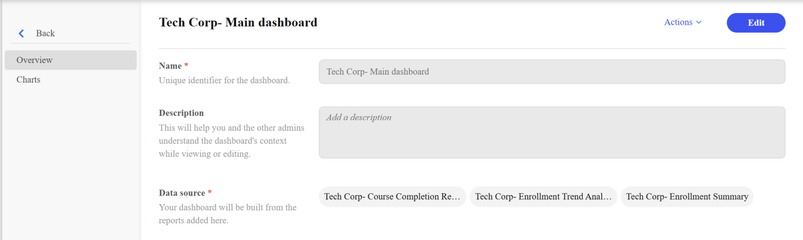

# Visualizações em Report Builder

As visualizações no Adobe Learning Manager Report Builder transformam um relatório salvo em gráficos e painéis. Você pode comparar grupos, identificar tendências e compartilhar resultados sem alterar a forma dos dados em uma ferramenta de planilha.

>[!IMPORTANT]
>
>As visualizações (gráficos e painéis) no Report Builder estão disponíveis apenas para clientes do Adobe Learning Manager Ultimate. Eles não estão disponíveis com a edição Prime.

## Sobre visualizações no Report Builder {#about-visualizations}

Uma visualização é um gráfico, ou um painel de gráficos, criado a partir de um relatório salvo em Report Builder. Você escolhe quais colunas do relatório plotar e o Report Builder desenha o gráfico a partir dos dados do relatório. Você pode plotar colunas diretamente ou plotar dados resumidos de um relatório.

* **Criar gráficos para um relatório:** abra o relatório, selecione **Visualização** e crie gráficos. Consulte [Criar um gráfico a partir de um relatório](#create-chart-from-report).
* **Agrupar gráficos em um painel:** escolha relatórios como uma fonte de dados e adicione gráficos deles. Consulte [Criar um painel](#build-dashboard).
* **Compartilhar e exibir:** compartilhe um painel com administradores, que o exibem e filtram no modo somente leitura.

Gráficos funcionam de dois modos:

* **Modo de configuração:** crie ou edite o gráfico.
* **Modo de exibição:** filtre o que o gráfico exibe sem alterar como ele é compilado.

## Tipos de gráfico e quando usá-los {#chart-types}

Escolha o tipo de gráfico pela pergunta que deseja responder.

| Tipo de gráfico | Use-o para | Exemplo |
|---|---|---|
| Linha | Mostrar como um valor muda ao longo do tempo. | Inscrições por mês de criação |
| Barra ou coluna | Comparar valores entre categorias. Layouts agrupados, empilhados e 100% empilhados estão disponíveis. | Alunos por status de inscrição |
| Pizza | Mostrar a parte de cada categoria de um todo. Segmentos abaixo de 1% são agrupados em um segmento **Outros**. | Inscrições por catálogo |
| Número grande | Destaque uma métrica importante. | Total de conclusões deste trimestre |
| Tabela | Mostrar valores exatos. Você pode escolher um subconjunto de colunas e mostrar uma coluna de data como linhas em vez de colunas (exibição de coluna para linha). | Tempo de aprendizado gasto por usuário, por mês |

>[!NOTE]
>
>Os gráficos de linha criados a partir de relatórios de tendência, como inscrições por mês, mostram o instantâneo atual dos dados agrupados por data. Eles não mostram como os dados eram exibidos em cada data passada. Para obter mais informações, consulte Conceitos e terminologia do Report Builder.

## Termos de visualização {#visualization-terms}

| Prazo | Significado |
|---|---|
| Relatório | Uma configuração de Report Builder salva de colunas, filtros e agrupamentos. Os gráficos são criados a partir de relatórios. |
| Filtro em nível de gráfico | Um filtro que você define ao criar ou editar um gráfico. Limita os dados que os gráficos representam. |
| Filtro de nível de página | Um filtro que um visualizador aplica a todos os gráficos em uma página ou painel. Ele pode reduzir, mas não ampliar, os próprios filtros do relatório. |
| painel do Report Builder | Uma página de gráficos que você constrói em Report Builder. |

## Criar um gráfico a partir de um relatório {#create-chart-from-report}

Crie um gráfico a partir de um relatório salvo para ver dados de inscrição, conclusão ou tempo gasto rapidamente. Você configura o gráfico uma vez e ele é desenhado a partir dos dados do relatório toda vez que é aberto.

### Antes de criar um gráfico {#before-you-create-chart}

Confirme o seguinte:

* **Salvar o relatório.** A opção para adicionar um gráfico aparece na página de Report Builder após salvar o relatório.
* **Usar seu próprio relatório.** Duplique um relatório compartilhado para criar sua própria cópia e use-o para criar gráficos.
* **Verifique o tamanho.** Um relatório com mais de 10 milhões de linhas não pode ser plotado. Um relatório resumido com mais de 10.000 pontos de dados não é plotado. Consulte Limites do gráfico e do painel.
* **Conheça suas colunas.** O eixo X (dimensão) e o eixo Y (medida) do gráfico provêm das colunas do relatório. Para resumir o relatório em si, use **Agrupar por** e agrega. Para obter mais informações, consulte Aplicar agrupar por e agregações.

### Configurar um gráfico {#configure-chart}

1. Faça logon no Adobe Learning Manager como administrador.
1. Selecione **Relatórios** e selecione **Report Builder**.
1. Selecione a guia **Relatórios** e abra um relatório salvo. Para este exemplo, selecione um relatório de tendência de logon de usuário, que mostra o número de usuários que fizeram logon na plataforma de aprendizado em cada data.
1. Na navegação à esquerda, selecione **Visualização**. Um painel é aberto com as guias **Configuração** e **Estilo**.

   

   >[!NOTE]
   >
   >Depois de existir um gráfico, selecione **Editar** e selecione **+** para adicionar outro gráfico.

1. Em **Tipo de gráfico**, selecione um tipo, como **Gráfico de linhas**. Esse campo é obrigatório.
1. Ao lado de **Dimension - Eixo X**, selecione o ícone Adicionar e selecione a coluna de relatório. Para uma coluna de data, selecione também uma **Granularidade de data**, como dia ou mês.

   {width="650"}

1. Selecione **Adicionar** para adicionar a dimensão de data.
1. Ao lado de **Medida - Eixo Y**, selecione o ícone de adição e, em seguida, selecione a coluna do relatório e como agregá-la, como **Contagem**.

   {width="650"}

1. Selecione **Adicionar** para adicionar a medida.
1. (Opcional) Selecione **Adicionar filtro** para limitar os dados plotados em um intervalo, como os últimos 30 dias. Selecione **Adicionar**.

   {width="650"}

1. (Opcional) Adicione uma coluna **Classificar** e selecione **Crescente** ou **Decrescente**. Selecione **Adicionar**.

   {width="650"}

1. (Opcional) Para um gráfico de linhas, defina **Tratamento de espaços** para dados ausentes. Consulte [Tratamento de lacunas para dados ausentes](#gap-handling).
1. Em **Máximo de pontos de dados**, insira o número de pontos de dados a serem plotados no gráfico. O padrão é 100 pontos e o limite é 10.000.
1. Ative o **Agrupar restante dos pontos como &#39;outros&#39;**. O Report Builder exibe pontos de dados individuais até o valor **Máximo de pontos de dados** e combina tudo além desse limite em uma categoria adicional chamada **Outros**.

   Por exemplo, se o **Máximo de pontos de dados** for 150 e sua consulta retornar 200 pontos:

   * Report Builder exibe 150 pontos individualmente.
   * O Report Builder combina os 50 pontos restantes em **Outros**.
   * O gráfico mostra 151 pontos plotados: 150 mais **Outros**.

1. Selecione **Próximo**. Agora você pode personalizar seu gráfico.

   {width="650"}

#### Tratamento de lacunas para dados ausentes {#gap-handling}

A manipulação de espaços define o que o gráfico faz quando uma ou mais observações em uma série não têm valor numérico, como NULL, NA, NaN ou uma célula vazia.

Suponha que os dados sejam:

| X | Valor |
|---|---|
| jan | 10 |
| fev | 15 |
| Mar | N/A |
| abr | N/A |
| Maio | 25 |

A tabela a seguir mostra os três comportamentos.

| Tratamento de lacunas | Resultado conceitual | Como é plotado |
|---|---|---|
| Linha até zero | `10 -> 15 -> 0 -> 0 -> 25` | Trata valores ausentes como 0. |
| Ignorar | `10 -> 15   25` | Não traça os pontos faltantes, e quebra a linha. |
| Conectar | `10 -> 15 ----> 25` | Não traça os pontos faltantes, mas conecta as observações válidas de ambos os lados. |

>[!NOTE]
>
>Connect não é interpolação. Se março e abril estiverem ausentes, a conexão direta de fevereiro a maio apenas traçará uma linha visual entre os dois valores conhecidos. Ela não cria valores reais de março e abril.

### Personalizar o gráfico {#customize-chart}

Personalize um gráfico para torná-lo claro e fácil de ler. Na guia **Estilo**, você pode adicionar um título, mostrar ou ocultar títulos de eixo e legendas, posicionar e alinhar a legenda e definir uma cor para cada série. As alterações de estilo afetam apenas a aparência do gráfico. Eles não alteram os dados que plotam.

1. Para mostrar um título acima do gráfico, selecione **Mostrar título para o gráfico**. Para ocultá-lo, desative a opção.
1. Em **Título do gráfico**, insira um título para o gráfico.
1. Selecione **Mostrar título para o Eixo X** e **Mostrar título para o Eixo Y** para rotular os eixos.
1. Para mostrar uma chave que identifica cada linha, selecione **Mostrar legendas**.
1. Em **Posição da legenda**, selecione o ícone esquerdo, central ou direito para alinhar a legenda.
1. Em **Cor da linha**, selecione a amostra de cor ao lado de uma série, como **Número de usuários**.
1. No seletor de cores, escolha uma cor da paleta ou use a guia personalizada para definir sua própria cor.
1. Repita as duas etapas anteriores para cada linha que deseja recolorir.
1. Selecione **Criar** para adicionar o gráfico. Se você estiver editando um gráfico existente, selecione **Salvar**.

   {width="650"}

O gráfico aparece com os títulos, a legenda e as cores da linha.

>[!TIP]
>
>* Escolha cores que contrastem claramente entre si e com o plano de fundo. Mantenha os títulos e a legenda ativados para que a cor não seja a única maneira de diferenciar as linhas.
>* As opções **Posição da legenda**, **Alinhamento da legenda** e **Cor da linha** aplicam-se somente quando a opção **Mostrar legendas** está ativada.
>* Cada linha do gráfico tem sua própria amostra, uma por medida adicionada na guia **Configuração**.

Para organizar gráficos em uma única página, consulte [Criar um painel](#build-dashboard).

## Criar um gráfico de pizza {#create-pie-chart}

Use um gráfico de pizza para mostrar como um todo se divide em partes, como a parcela de funcionários que concluíram o treinamento obrigatório ou a combinação de formatos de curso. Cada fatia mostra a participação de uma categoria do total.

### Sobre gráficos de pizza {#about-pie-charts}

Um gráfico de pizza desenha uma fatia por categoria. O tamanho da fatia mostra a parte da categoria da medida total. Uma legenda identifica cada fatia, e cada uma exibe seu valor.

Use um gráfico de pizza para mostrar partes de um todo em algumas categorias, quando os espectadores precisarem de proporções maiores do que valores exatos. Para comparar muitas categorias, use um gráfico de barras. Para mostrar alterações ao longo do tempo, use um gráfico de linhas.

### Etapas para criar um gráfico de pizza {#pie-chart-steps}

Antes de começar, salve o seu relatório. Inclua uma coluna para as categorias e uma coluna para medir.

1. Selecione **Relatórios** e selecione **Report Builder**. Na guia **Relatórios**, abra o relatório salvo.
1. Na navegação à esquerda, selecione **Visualização**.
1. Em **Tipo de gráfico**, selecione **Gráfico de pizza**.
1. Ao lado de **Dimension - Segmento**, selecione o ícone Adicionar e, em seguida, selecione a coluna que define as fatias. Por exemplo, selecione **Transcrição (Objeto de aprendizado) - Status**.
1. Ao lado de **Medida - Valor**, selecione o ícone Adicionar e, em seguida, selecione a coluna e a agregação que dimensionam as fatias, como **Contagem**.
1. (Opcional) Em **Máximo de pontos de dados**, insira o número máximo de fatias a serem desenhadas. O padrão é 100.
1. (Opcional) Para combinar categorias secundárias, ative o **Agrupar restante dos pontos como &#39;outros&#39;**.
1. Selecione **Avançar** para personalizar o gráfico de pizza.

### Personalizar o gráfico de pizza {#customize-pie-chart}

1. Para mostrar um título, ative **Mostrar título para o gráfico**. Desative para ocultar o título.
1. Em **Título do gráfico**, insira um título, como `Mandatory Compliance Completion`.
1. No **estilo de gráfico**, selecione **Pizza** para um círculo sólido ou **Rosca** para um anel.
1. Selecione **Mostrar legendas** para exibir a legenda no gráfico.
1. Em **Posição da legenda**, selecione onde a legenda aparece.
1. Em **Alinhamento da legenda**, selecione à esquerda, centralizado ou à direita.
1. Selecione **Criar** para um novo gráfico. Ao editar um gráfico existente, selecione **Salvar** e **Salvar** na página **Visualização**.

   {width="650"}

Report Builder cria o gráfico de pizza ou rosca.

## Criar um gráfico de barras {#create-bar-chart}

Use um gráfico de barras para comparar uma medida entre categorias, como status de treinamento por equipe ou tempo de aprendizado por cliente. As barras são fáceis de comparar e classificar, e você pode agrupá-las ou empilhá-las para adicionar uma segunda divisão.

### Sobre gráficos de barras {#about-bar-charts}

Um gráfico de barras desenha uma barra para cada categoria no eixo X. O comprimento da barra mostra a medida no eixo Y, como uma contagem de alunos. Você pode desenhar barras verticalmente (colunas) ou horizontalmente.

Use um gráfico de barras para:

* Compare valores entre categorias, como equipes, parceiros ou clientes.
* Classifique as categorias da mais alta para a mais baixa.
* Mostra uma segunda divisão dentro de cada barra, como o status dentro de cada parceiro.

### Antes de criar um gráfico de barras {#before-you-create-bar-chart}

* Salve o relatório e use o seu próprio relatório.
* Inclua uma coluna para as categorias e uma coluna para medir.
* Mantenha o relatório dentro dos limites do Gráfico e do painel.

### Etapas para criar um gráfico de barras {#bar-chart-steps}

1. Selecione **Relatórios** e selecione **Report Builder**. Na guia **Relatórios**, abra o relatório salvo.
1. Na navegação à esquerda, selecione **Visualização**.
1. Em **Tipo de gráfico**, selecione **Gráfico de barras**.
1. Ao lado de **Dimension - Eixo X**, selecione o ícone Adicionar e, em seguida, selecione a coluna que define as categorias. Selecione **Concluído**.

   {width="650"}

1. Ao lado de **Medida - Eixo Y**, selecione o ícone de adição e, em seguida, selecione a coluna e como agregá-la, como **Contagem**. Selecione **Concluído**.

   {width="650"}

1. (Opcional) Adicione **Filtros** para limitar os dados e defina **Classificar** para ordenar as barras por coluna.
1. Em **Máximo de pontos de dados**, insira o número máximo de pontos de dados para plotar. Se você inserir 150, o Report Builder exibirá até 150 pontos de dados individuais e combinará tudo além desse limite em uma categoria adicional chamada **Outros**.
1. Selecione **Avançar** para personalizar o gráfico de barras.

### Personalizar o gráfico de barras {#customize-bar-chart}

Use a guia **Estilo** para definir o título, a orientação, o agrupamento, a legenda e as cores. As configurações de estilo alteram a aparência do gráfico, não os dados plotados por ele.

1. Selecione a guia **Estilo**.
1. Para mostrar um título, ative **Mostrar título para o gráfico**. Em **Título do gráfico**, insira um título, como `Most Popular Courses`.
1. Para rotular os eixos, ative **Mostrar título para o Eixo X** e **Mostrar título para o Eixo Y**. Desative uma opção para ocultar esse título.
1. No **estilo de gráfico**, selecione **Vertical** para colunas ou **Horizontal** para barras que se movem lateralmente. As barras horizontais deixam mais espaço para nomes de categoria longos.
1. No **Agrupamento de barras**, selecione um dos três ícones para definir como várias séries compartilham uma categoria: agrupadas, empilhadas ou 100% empilhadas.
1. Para identificar cada série, ative o **Mostrar legendas**.
1. Em **Posição da legenda**, selecione onde a legenda aparece. Em **Alinhamento da legenda**, selecione à esquerda, centralizado ou à direita.
1. Em **Cor da barra**, selecione a amostra ao lado de uma série e escolha uma cor.
1. Selecione **Criar** para um novo gráfico. Ao editar um gráfico existente, selecione **Salvar**.

>[!NOTE]
>
>O **agrupamento de barras** só é importante quando uma barra tem mais de uma série, como duas medidas. Mantenha a legenda ativada e mostre os rótulos de dados, portanto, a cor não é a única maneira de diferenciar as séries.

## Criar um número grande {#create-big-number}

Use um número grande para mostrar uma métrica-chave como uma figura grande e fácil de ler, como o total de alunos, inscrições vencidas ou usuários ativos. Números grandes funcionam bem na parte superior de um painel, em que os espectadores verificam os principais números primeiro.

### Sobre números grandes {#about-big-numbers}

Um número grande é um ladrilho com duas partes: um valor e um rótulo. O valor é um único número calculado a partir do seu relatório, como uma contagem ou uma soma. O rótulo informa aos espectadores o que o número significa. Um número grande não possui eixos, legendas ou categorias.

Use um número grande para:

* Mostrar um número de manchete que alguém verifica regularmente.
* Forneça contexto a um painel antes dos gráficos detalhados abaixo dele.

### Etapas para criar um número grande {#big-number-steps}

Antes de começar, salve o seu relatório. Decida o número desejado e qual coluna e agregação a produzirão.

Por exemplo, os administradores de treinamento informam mensalmente sobre o treinamento que a organização realizou. Os líderes desejam uma figura de título, não uma lista de inscrições, e os administradores desejam atualizá-la sem reconstruir o relatório.

1. Selecione **Relatórios** e selecione **Report Builder**. Na guia **Relatórios**, abra o relatório salvo.
1. Na navegação à esquerda, selecione **Visualização**.
1. Em **Tipo de gráfico**, selecione **Número Grande**.
1. Em **Medida - Valor**, selecione **Transcrição (Objeto de Aprendizado) - Status** e aplique a agregação **Contagem**. Selecione **Concluído**.

   {width="650"}

1. Selecione o número de dígitos a serem exibidos após a vírgula decimal. Você pode selecionar no máximo dois dígitos.
1. Em **Unidade de exibição**, selecione como os números grandes serão encurtados. Selecione **K** para milhares, **M** para milhões, **B** para bilhões, ou **Nenhum** para mostrar o valor total. **Automático** seleciona a unidade apropriada automaticamente. Selecione **Próximo**.

   {width="650"}

### Personalizar o número grande {#customize-big-number}

Use a guia **Estilo** para personalizar as propriedades de legenda do número grande.

1. Em **Título da legenda**, insira o texto que nomeia o número. Por exemplo, insira `Total Course Completions`.
1. Em **Posição da legenda**, selecione um dos dois ícones para definir onde o título será exibido.
1. Em **Alinhamento da legenda**, selecione à esquerda, centralizado ou à direita.
1. Selecione **Criar** para um novo gráfico. Ao editar um gráfico existente, selecione **Salvar**.

   {width="650"}

## Criar uma tabela ou um gráfico dinâmico {#create-table-pivot-chart}

Use uma tabela dinâmica para resumir um número em duas categorias, como quantos alunos de cada equipe de gerente concluíram, iniciaram ou não iniciaram o aprendizado obrigatório. Você também pode alternar para uma exibição de estilo de tabela dinâmica, na qual as datas ou categorias são executadas na parte superior da tabela, de modo que cada aluno ou curso se ajuste em uma linha.

### Sobre tabelas e gráficos dinâmicos {#about-table-pivot}

Uma tabela dinâmica é uma grade com uma categoria na lateral, uma categoria na parte superior e um número em cada célula. Cada célula mostra a medida para um valor de linha e um valor de coluna. Você o compila com três configurações na guia **Configuração**.

| Configuração | O que ela faz | No exemplo |
|---|---|---|
| **Dimension - Colunas** | Os valores desse campo se tornam os cabeçalhos de coluna na parte superior. | **Transcrição (Objeto De Aprendizado) - Status**: Concluída, Em Andamento, Não Iniciada |
| **Dimension - Linhas** | Os valores desse campo se tornam os rótulos de linha no lado esquerdo, uma linha para cada valor. | **Usuário - Nome do Gerente** |
| **Medida - Valor** | O número em cada célula. Você escolhe uma coluna e uma agregação, como **Contagem**. Aparece como o nome da coluna seguido por **Agregado por: Count**. | Contagem de alunos |

Uma dimensão é um campo pelo qual você agrupa. Uma medida é um número calculado.

### Antes de criar um gráfico de tabela {#before-you-create-table-chart}

* Para usar a exibição de coluna para linha, agrupe o relatório pela coluna desejada como cabeçalhos, como uma data.
* Se você agrupar por mais de uma coluna de data, escolha uma delas para os cabeçalhos.

### Etapas para criar um gráfico de tabela {#table-chart-steps}

1. Selecione **Relatórios** e selecione **Report Builder**. Na guia **Relatórios**, abra o relatório salvo.
1. Na navegação à esquerda, selecione **Visualização**.
1. Em **Tipo de gráfico**, selecione **Tabela/Tabela Dinâmica**.
1. Ao lado de **Dimension - Linhas**, selecione o ícone Adicionar e, em seguida, selecione **Usuário - Nome do Gerente**.
1. Ao lado de **Dimension - Colunas**, selecione o ícone Adicionar e selecione **Transcrição (Objeto de Aprendizado) - Status**.
1. Ao lado de **Medida - Valor**, selecione o ícone de adição. Selecione a medida **Transcrição (Objeto de Aprendizado) - Status** e selecione **Adicionar**.

   {width="650"}

1. Ative uma ou ambas as opções a seguir, com base nos seus requisitos de relatório:

   * **Mostrar total geral para colunas:** exibe o total geral para cada coluna. Por exemplo, se a tabela exibir dados de vendas em diferentes regiões, o total geral mostrará o total de vendas de cada coluna.
   * **Mostrar total geral para linhas:** exibe o total geral para cada linha. Por exemplo, se a tabela exibir vendas mensais entre diferentes produtos, o total geral mostrará as vendas totais para cada linha.

1. Em **Número de linhas a serem exibidas (máx. 20)**, insira quantas linhas serão mostradas na tabela de uma vez. O padrão é 10 e o máximo é 20. Por exemplo, 15 exibe 15 linhas por página.
1. Selecione **Próximo**.

### Personalizar a tabela {#customize-table}

Use a guia **Estilo** para adicionar o título do gráfico, colorir o cabeçalho da tabela e colorir as linhas da tabela.

1. Em **Título do gráfico**, insira o título que você deseja exibir, como `Status of Learning`.
1. Selecione **Cor da linha de cabeçalho** para aplicar uma cor de plano de fundo à linha de cabeçalho.
1. Ative **Realçar linhas alternativas** para aplicar cores alternadas a linhas para facilitar a leitura.
1. Selecione **Cor 1** e escolha a primeira cor para as linhas alternadas.
1. Selecione **Cor 2** e escolha a segunda cor para as linhas alternadas.
1. Selecione **Salvar** para aplicar as configurações de estilo ao gráfico.

## Criar um painel {#build-dashboard}

Um painel de controle coloca os gráficos de um ou mais relatórios em uma única página. Crie um quando você responder às mesmas perguntas repetidamente, como quantas pessoas terminaram o treinamento este mês ou quais equipes estão atrasadas.

### Sobre painéis do Report Builder {#about-dashboards}

Um painel é uma página de gráficos. Você escolhe os relatórios dos quais ele é extraído, chamado de origem de dados, e adiciona gráficos desses relatórios. Os gráficos sempre vêm de relatórios, portanto, crie-os primeiro em cada página de **Visualização** de relatório. Você só pode usar os relatórios que possui. O escopo se aplica a todos os gráficos do painel.

### Criar o painel {#create-dashboard}

1. Selecione **Relatórios** > **Painéis**. A página lista todos os painéis que você criou.
1. Selecione **Criar Painel**.
1. Insira o nome e a descrição do painel.

   {width="650"}

1. Em **Fonte de dados**, selecione **Adicionar relatório** para adicionar os gráficos pré-criados dos relatórios disponíveis.
1. Selecione um ou mais relatórios na lista e selecione **Adicionar**.

   {width="650"}

O Report Builder adiciona os relatórios ao painel.

{width="650"}

### Exibir os gráficos no painel {#view-charts}

Selecione **Gráficos** no painel de navegação à esquerda do painel.

{width="650"}

Todos os gráficos dos relatórios disponíveis aparecem no painel.

{width="650"}

### Mover gráficos no painel {#move-charts}

1. Selecione **Editar** no canto superior direito do painel. Você pode exibir as colunas de cada relatório que foram usadas para criar os gráficos. Você também pode criar outro gráfico para adicionar ao painel.

   {width="650"}

1. No painel esquerdo, selecione os gráficos que você deseja adicionar ao painel.
1. Arraste cada gráfico para a posição desejada e solte-o para posicionar o gráfico.
1. Repita a etapa anterior para organizar os gráficos de acordo com seus requisitos de relatório.
1. Selecione **Salvar** para salvar todas as alterações no painel.

### Compartilhar um painel {#share-dashboard}

Compartilhe um painel do Report Builder com outros administradores para que eles possam visualizar os mesmos gráficos e dados.

Os gráficos criados a partir de um relatório são salvos com esse relatório. Quando você compartilha o relatório, outros administradores também recebem os gráficos. Compartilhar um painel uma vez em vez de solicitar que cada administrador o reconstrua.

#### Compartilhar um painel com outros administradores {#share-with-administrators}

1. Faça logon no Adobe Learning Manager como administrador.
1. Selecione **Relatórios** e selecione **Report Builder**.
1. Selecione a guia **Relatórios** e abra o relatório que contém o painel.
1. Selecione **Ações** > **Compartilhar**.
1. Em **Compartilhar**, selecione **Editar**.
1. Selecione o campo **Selecionar usuários/grupos de usuários**.
1. Pesquise e selecione os administradores ou grupos de usuários com os quais deseja compartilhar.

   {width="650"}

1. Selecione **Salvar**.

Os administradores selecionados agora podem exibir o relatório e seus gráficos em sua exibição de Report Builder.

>[!NOTE]
>
>Os administradores com acesso compartilhado podem exibir, duplicar e editar o relatório.

#### Remover acesso compartilhado {#remove-shared-access}

1. Abra o relatório e selecione **Ações** > **Compartilhar**.
1. Em **Compartilhar**, selecione **Editar**.
1. Desmarque o administrador ou grupo de usuários.
1. Selecione **Salvar**.

#### Práticas recomendadas de compartilhamento {#sharing-best-practices}

* Compartilhar um relatório bem configurado em vez de permitir que cada administrador crie uma variação. Isso mantém uma versão autoritativa dos dados.
* Crie o relatório com filtros que se apliquem a todos com quem você compartilhá-lo, para que todos os visualizadores vejam gráficos consistentes.

### Excluir um painel {#delete-dashboard}

Exclua um Report Builder dashboard quando não precisar mais dele. A exclusão de um painel de controle o remove permanentemente e suas configurações de compartilhamento associadas. Não é possível desfazer esta ação.

1. Faça logon no Adobe Learning Manager como administrador.
1. Selecione **Relatórios** e selecione **Report Builder**.
1. Selecione a guia **Relatórios** e abra o painel que você deseja excluir.
1. Selecione **Ações** > **Excluir**. A caixa de diálogo **Confirmação necessária** aparece. Isso exibe o nome do painel e os usuários com os quais o painel é compartilhado.

   {width="650"}

1. Selecione uma das seguintes opções:

   * **Editar compartilhamento:** revise ou altere os usuários com os quais o painel é compartilhado.
   * **Cancelar:** feche a caixa de diálogo sem excluir o painel.
   * **Excluir o painel:** exclua permanentemente o painel e remova suas configurações de compartilhamento.