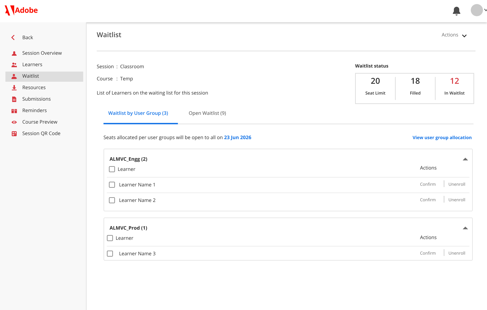

# Gerenciamento de listas de espera e participações

Os administradores podem gerenciar a presença e as listas de espera dos cursos dos alunos.

## Gerenciamento de listas de espera {#waitlistmanagement}

Os alunos são colocados em lista de espera de um curso em sala de aula quando as vagas são limitadas, com base na ordem de inscrição. Quando todas as licenças reservadas para um grupo de usuários são preenchidas, os membros adicionais desse grupo são colocados na lista de espera do grupo. Os alunos fora dos grupos de usuários são colocados na **Abrir Lista de Espera**.

Os administradores podem revisar a lista de espera e gerenciar os alunos na lista de espera. O Adobe Learning Manager também pode promover alunos na lista de espera automaticamente quando uma vaga se torna disponível.

Para gerenciar alunos na lista de espera:

1. Selecione **Cursos** no painel esquerdo.
1. Selecione o nome de um curso em sala de aula nos cursos disponíveis.

   Uma nova página é exibida com informações detalhadas sobre o curso.

1. Selecione **Lista de espera** no painel esquerdo da página de detalhes do curso.

   A página da lista de espera é aberta com o seguinte **status da lista de espera**:

   * **Limite de vagas:** Número total de vagas disponíveis para a sessão.
   * **Preenchido:** número de licenças atualmente ocupadas.
   * **Na Lista de Espera:** Número de alunos aguardando inscrição.

1. Selecione as seguintes guias na página **Lista de espera**:

   1. **Lista de espera por grupo de usuários**: lista os alunos na lista de espera em cada grupo de usuários.

   >[!NOTE]
   >
   >Esta guia aparecerá somente se a configuração **Registro de Grupo** estiver habilitada.

   1. **Abrir Lista de Espera**: lista os alunos na lista de espera que não estão reservados para nenhum grupo de usuários.

   

1. Ao lado de um aluno, selecione uma das seguintes ações:

   | **Ação** | **Descrição** |
   |---|---|
   | **Confirmar** | Inscreve o aluno na lista de espera na sessão e o remove da lista de espera. |
   | **Cancelar inscrição** | Remove o aluno da lista de espera e atualiza as posições dos alunos restantes na lista de espera. |

## Gerenciamento de participação {#attendancemanagement}

Este recurso se aplica somente a cursos em sala de aula e sala de aula virtual. Você pode registrar a participação seguindo as etapas abaixo:

1. Clique em Cursos no painel esquerdo depois de fazer logon como administrador.
1. Na lista de cursos disponíveis, clique no nome do curso de qualquer módulo de sala de aula/curso da sua escolha. Uma nova página é exibida com informações detalhadas sobre o curso.
1. Clique na guia Participação, selecione os alunos e clique em Salvar para marcar a participação.

>[!NOTE]
>
>Se houver vários módulos em um curso e o aluno tiver concluído apenas um deles, você pode selecionar um único módulo e clicar em Salvar. Se o aluno concluir todos os módulos de um curso, você pode clicar na opção Selecionar tudo e clicar em Salvar.

A participação na sessão de sala de aula virtual baseada no Adobe Connect é marcada automaticamente de 2 a 3 horas após a sessão. A conclusão do curso da sala de aula virtual do aluno é marcada somente depois que a participação é marcada.
