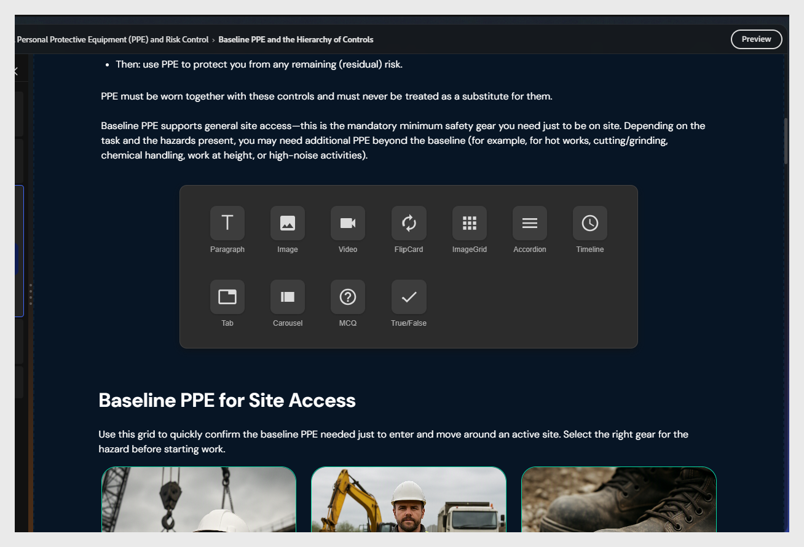
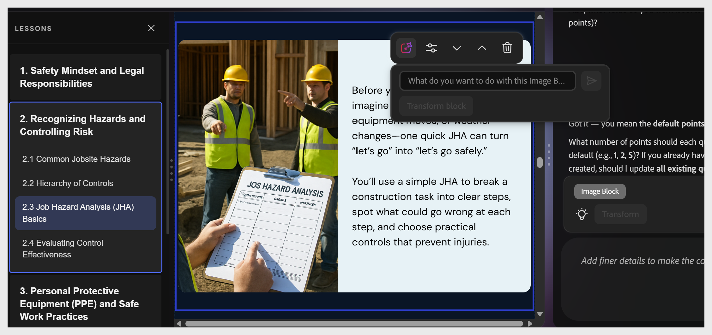

# Adicionar um componente de conteúdo

Selecione entre dois elementos existentes. O botão + é exibido. Selecione-o para abrir o seletor de componentes.

Componentes disponíveis:

<table>
  <thead>
    <tr>
      <th>Componente</th>
      <th>Usar para</th>
    </tr>
  </thead>
  <tbody>
    <tr>
      <td><strong>Parágrafo</strong></td>
      <td>Corpo de texto e explicações</td>
    </tr>
    <tr>
      <td><strong>Imagem</strong></td>
      <td>Ilustrações, capturas de tela, diagramas</td>
    </tr>
    <tr>
      <td><strong>Vídeo</strong></td>
      <td>MP4 incorporado ou vídeo vinculado</td>
    </tr>
    <tr>
      <td><strong>Virar cartão</strong></td>
      <td>Pares de termos ou definições, revelar interações</td>
    </tr>
    <tr>
      <td><strong>Grade de imagem</strong></td>
      <td>Várias imagens em um layout de grade</td>
    </tr>
    <tr>
      <td><strong>Acordeão</strong></td>
      <td>Seções expansíveis, procedimentos passo a passo</td>
    </tr>
    <tr>
      <td><strong>Linha do tempo</strong></td>
      <td>Eventos sequenciais ou etapas do processo</td>
    </tr>
    <tr>
      <td><strong>Objeto da Web</strong></td>
      <td>Incorporar conteúdo externo da Web, uma página da Web, uma ferramenta interativa, uma pesquisa ou um aplicativo da Web diretamente em um slide de tópico</td>
    </tr>
    <tr>
      <td><strong>Guia</strong></td>
      <td>Conteúdo paralelo — comparações, variantes regionais</td>
    </tr>
    <tr>
      <td><strong>Carrossel</strong></td>
      <td>Séries de imagens ou cartões de conteúdo que podem ser trocados</td>
    </tr>
    <tr>
      <td><strong>MCQ</strong></td>
      <td>Verificação de conhecimento em linha não graduado</td>
    </tr>
    <tr>
      <td><strong>Verdadeiro/falso</strong></td>
      <td>Verificação embutida de verdadeiro ou falso não graduada</td>
    </tr>
  </tbody>
</table>

>[!NOTE]
>
>Use o **Acordeão** para procedimentos passo a passo nos quais os alunos se beneficiam ao controlar seu ritmo. Use **Inverter cartão** para conteúdo de termos ou definições.

## Adicionar um objeto da Web a um curso do Compositor de conteúdo

Um objeto da Web exibe conteúdo externo em um quadro incorporado no curso. Os alunos interagem com o conteúdo sem sair do curso. Use-o para ferramentas interativas, formulários incorporados, pesquisas ou qualquer recurso baseado na Web que ofereça suporte à incorporação de iframe.

### Adicionar um objeto da Web

1. Abra o curso no Compositor de conteúdo e navegue até o tópico em que deseja adicionar o Objeto da Web.
2. Selecione entre dois elementos existentes no slide de tópico. O botão **+** é exibido.
3. Selecione **+** para abrir o seletor de componentes.
4. Selecione **Objeto da Web**. O bloco aparece na tela.

### Configurar o objeto da Web

Selecione o ícone **Configurações** na barra de ferramentas do bloco de Objetos da Web para abrir o painel de configuração.

### Definir a fonte de conteúdo

Em **Conteúdo**, selecione como o conteúdo externo é carregado:

- **URL** — insira o endereço Web da página ou ferramenta que você deseja incorporar. O conteúdo é carregado dentro do curso em um quadro incorporado.
- **Código incorporado** — cole um trecho incorporado de um serviço de terceiros. Use isso para ferramentas que fornecem seu próprio código incorporado, como formulários interativos, pesquisas ou reprodutores de mídia.
- **Sistema** — selecione o conteúdo de um sistema conectado ou de uma integração.

### Definir o height do quadro

No campo **height de Quadros**, defina o height do quadro de conteúdo inserido em pixels. Use os controles **+** e **-** para ajustar o valor. O padrão é 498 px.

Ajuste o height de quadro para corresponder ao height natural do conteúdo incorporado. Defini-lo como muito baixo adiciona uma barra de rolagem dentro do quadro; defini-lo como muito alto adiciona espaço em branco abaixo do conteúdo.

### Configurar opções de carregamento e exibição

- **Carregamento automático** — quando selecionado, o conteúdo da Web é carregado automaticamente quando um aluno chega ao slide. Desmarque essa opção para páginas com conteúdo intenso para evitar a lentidão do curso. Quando o carregamento automático está desativado, os alunos selecionam o quadro para acionar o carregamento.
- **Título do bloco** — ative para exibir um cabeçalho acima do bloco do Objeto da Web. Use isso para dar aos alunos contexto sobre o conteúdo incorporado antes que eles interajam com ele.

## Mover blocos de conteúdo dentro de um tópico

Você pode reordenar blocos de conteúdo dentro de um tópico usando as opções de edição na barra de ferramentas ou no AI.

