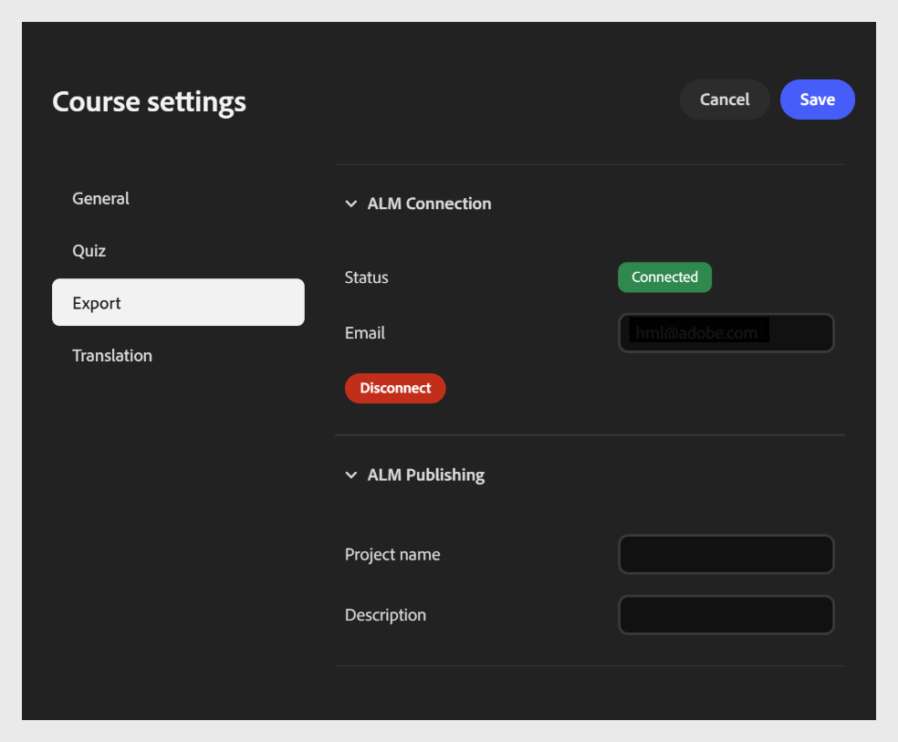
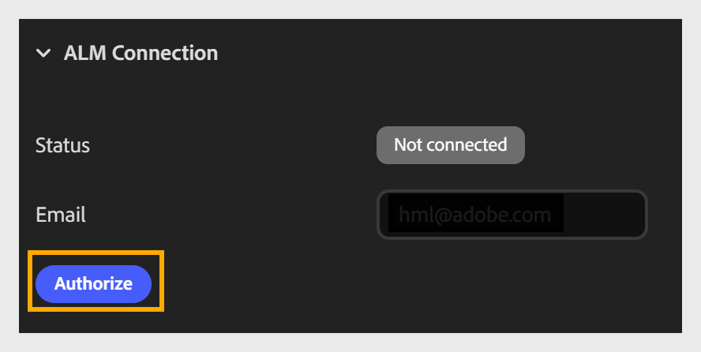
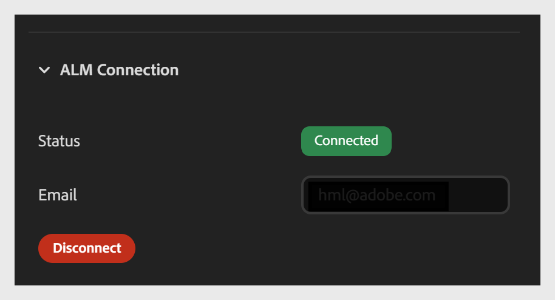

# Publish um curso do Compositor de conteúdo para o Adobe Learning Manager

A guia **Exportar** permite conectar seu curso ao Adobe Learning Manager (ALM) e publicá-lo diretamente na Biblioteca de Conteúdo do ALM. Para configurar a conexão, insira seu email no campo **Email**. Verifique se você tem uma conta do ALM com a mesma ID de logon de email. Depois de conectado, você pode publicar o curso no ALM como um módulo.

Esta conexão é uma configuração única por curso. Uma vez estabelecido, você não precisa se reconectar cada vez que publicar ou exportar.

Ele tem duas seções:

- Seção Conexão ALM

- Seção de publicação do ALM

**Para definir as configurações de exportação**

1. Abra **Configurações do curso** e selecione a guia **Exportar** à esquerda.

2. Expanda a seção **Conexão ALM** (se ainda não estiver expandida).

   - Insira seu endereço de **email** associado à sua conta da Adobe Learning Manager.

   - Selecione **Autorizar** para fazer logon e conectar o curso à sua conta do ALM.
     

   - Depois de autorizado, confirme as atualizações de campo de **Status** de **Desconectar** para **Conectado**.
     

## Detalhes da publicação do Adobe Learning Manager

Depois de conectar sua conta, configure os detalhes de publicação na seção Publicação do ALM.

- Insira um nome de **Projeto** para identificar o curso. Esse nome aparece como o título do curso na Biblioteca de conteúdo do ALM.

- Insira uma **Descrição** - um breve resumo do curso que aparece junto com ele na Biblioteca de Conteúdo do ALM, ajudando os alunos e administradores a entender seu propósito.

- Selecione **Publish** para enviar o curso para a Biblioteca de Conteúdo do ALM como um módulo.

## Navegação do aluno em cursos publicados do Compositor de conteúdo

Saiba como os alunos navegam nos cursos do Compositor de conteúdo publicados no Adobe Learning Manager ou exportados como pacotes SCORM, incluindo o sumário flexível e a navegação móvel.

## Sumário recolhível

Os cursos publicados no Adobe Learning Manager ou exportados como pacotes SCORM incluem um tutorial flexível e um painel de navegação de tópico.

Os alunos podem:

- **Expanda** o painel de navegação para procurar lições e tópicos e ir para qualquer seção.
- **Recolha** o painel de navegação para focar no conteúdo do curso sem que o painel ocupe espaço na tela.
O estado do painel é preservado à medida que os alunos se movem pelo curso.

## Navegação móvel

Em dispositivos móveis, a lição e a navegação de tópico são abertas como uma sobreposição de tela cheia, em vez de um painel lateral. Os alunos selecionam o ícone de navegação para abrir a sobreposição, navegar até a lição ou tópico desejado e selecioná-lo para navegar até lá.

A sobreposição fecha automaticamente depois que o aluno seleciona um destino, retornando-o ao conteúdo do curso.
