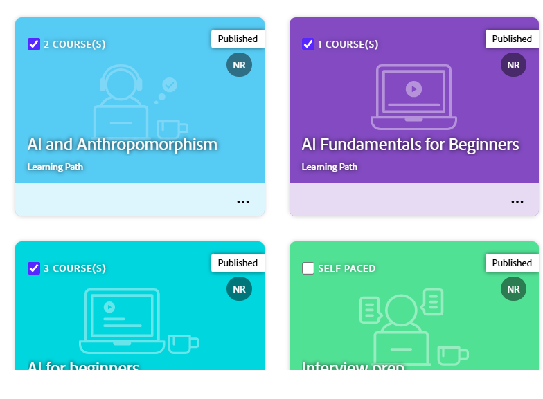
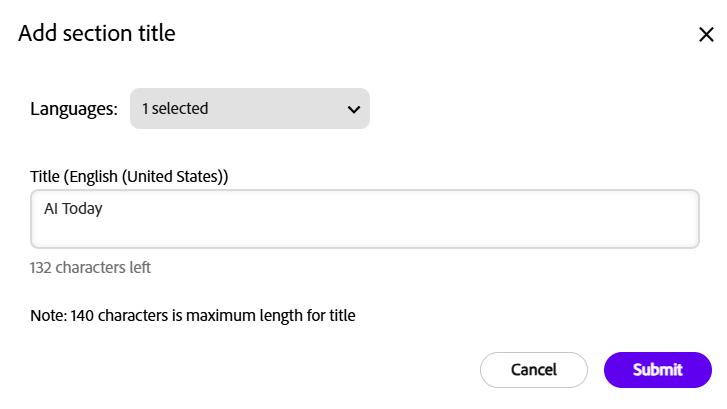

# Criar um caminho de aprendizado

Um autor pode criar um caminho de aprendizado para os alunos consumirem. Para criar um caminho de aprendizado no aplicativo Autor:

1. Faça logon como **Autor**.
1. Selecione **Aprendizado** > **Caminhos de aprendizado**.
1. Selecione **Adicionar**.

   

1. **Nome do Caminho de Aprendizado**: insira um nome para o caminho de aprendizado.
1. **Visão geral do caminho de aprendizado**: insira uma breve visão geral do caminho de aprendizado.
1. **Benefícios deste Caminho de Aprendizado**: descreva alguns benefícios do caminho de aprendizado.
1. **Marcas**: selecione as marcas apropriadas na lista predefinida.
1. **ID exclusiva do Objeto de Aprendizado**: insira uma ID exclusiva para o objeto de aprendizado.
1. **Tipo de inscrição**: selecione o tipo de inscrição no menu suspenso.
1. **Plano de Preços**: selecione **Pago** ou **Gratuito**. Se você selecionar **Gratuito**, a caixa **Preço do Caminho de Aprendizado** será desativada.
1. **Cancelar inscrição**: selecione esta opção para permitir que os alunos cancelem suas inscrições.
1. **Imagem de capa**: selecione uma imagem de capa para o caminho de aprendizado.
1. **Imagem do banner**: selecione uma imagem do banner para o caminho de aprendizado.
1. **Selecionar catálogos**: selecione os catálogos relevantes na lista.
1. **Rótulo de conformidade**: selecione o rótulo de conformidade apropriado na lista.
1. **Rótulos**: selecione o rótulo apropriado na lista.
1. **ID da Medalha de Crédito**: selecione o rótulo apropriado na lista.
1. **Nível de Dificuldade**: selecione o nível de dificuldade apropriado na lista.
1. **Conformidade**: selecione o nível de conformidade apropriado na lista.

   >[!NOTE]
   >
   > A qualquer momento antes de salvar, você pode adicionar um novo idioma selecionando a guia **Adicionar Novo Idioma**, selecionando um idioma na lista e selecionando **Salvar**. Inglês é o idioma padrão.

   

1. Selecione **Salvar**. É exibida uma nova página com o nome do caminho de aprendizado. Agora, você pode adicionar habilidades e produtos, organizar seções e adicionar cursos ou caminhos de aprendizado.

   

1. Selecione **As habilidades que os alunos receberão**. Na seção exibida, selecione as habilidades que deseja que os alunos adquiram e seus níveis.

   

1. Selecione **Adicionar**.
1. Selecione como deseja organizar seções e cursos ou programações de aprendizado. Selecione **Ordenado** ou **Não Ordenado**.
1. Em seguida, selecione **Adicionar Cursos ou Caminhos de Aprendizado**. Uma janela com cursos e caminhos de aprendizado existentes é exibida. Cada bloco mostra o nome, o tipo (curso ou caminho de aprendizado), o status de publicação e o formato do curso. Se for um curso, ele exibirá o tipo, como ritmo individualizado, virtual, sala de aula ou combinado. Se for um caminho de aprendizado, o número de cursos será exibido.

   

1. Selecione os cursos ou caminhos de aprendizado que deseja adicionar ao caminho de aprendizado.

   

1. Selecione **Adicionar**. Os cursos e os caminhos de aprendizado são exibidos na página Caminho de aprendizado.

   

1. Selecione **As habilidades que os alunos receberão**. Selecione as habilidades e os níveis. Selecione **Adicionar**.
1. Mapeie o caminho de aprendizado para produtos selecionando produtos na lista e, em seguida, selecionando seus níveis.

   >[!NOTE]
   >
   > Se você não selecionar pelo menos um produto, não poderá publicar o caminho de aprendizado.

   

1. Selecione como deseja organizar seções e cursos ou programações de aprendizado. Selecione **Ordenado** ou **Não Ordenado**.
1. Selecione **Adicionar título de seção** e insira um título de seção.

   

1. Selecione **Enviar**.
1. Selecione **Obrigatório** para tornar o caminho de aprendizado obrigatório. Se você não selecioná-lo, o caminho de aprendizado se tornará opcional.
1. Se quiser adicionar outra seção com um caminho de aprendizado diferente, repita as etapas 24 a 30.
1. **Requisitos de conclusão**: selecione **Todos** ou um número da lista para concluir o treinamento.
1. Mova os cursos para cima ou para baixo para alterar sua ordem.
1. Para remover um curso do caminho de aprendizado, selecione **X** no cartão do curso.
1. Selecione **Publish**. Para exibir o caminho de aprendizado recém-publicado, volte para a página **Caminhos de aprendizado**.
