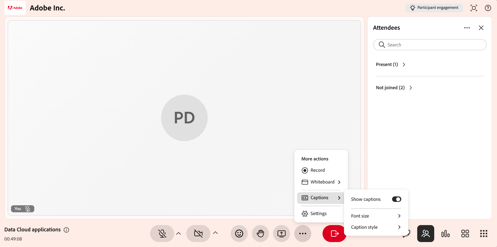

# Gerenciar legendas codificadas como professor

As legendas ocultas exibem o conteúdo falado como texto na tela, facilitando o acompanhamento de uma sessão do Live Hub, por exemplo, enquanto você apresenta, responde a perguntas dos participantes ou trabalha em um ambiente barulhento. Como professor, você pode gerenciar suas próprias legendas codificadas no menu de **Mais ações** da sala.

Este artigo explica como selecionar o idioma da legenda, exibir legendas codificadas e alterar a aparência durante uma sessão do Live Hub.

## Selecionar o idioma da legenda

Selecione o idioma usado para exibir as legendas durante a sessão. Todos os participantes veem legendas no idioma selecionado.

>[!NOTE]
>
>Os recursos viabilizados por IA estão disponíveis apenas para cursos em inglês. Se o idioma do curso estiver definido para outro idioma, a guia **Legendas** indicará que os recursos com IA não estão disponíveis.

Para selecionar o idioma da legenda:

1. Selecione **Mais ações** na barra de controle.
1. Selecione **Configurações**.

   A caixa de diálogo Configurações da sala é aberta.

1. Selecione **Legendas**.
1. Selecione um idioma no menu suspenso Idioma de exibição das legendas.
1. Selecione **Concluído**.

## Exibir legendas codificadas

Exiba legendas codificadas durante uma sessão do Live Hub para exibir a transcrição em tempo real do conteúdo falado.

Para ativar as legendas codificadas:

1. Selecione **Mais opções ( µ)** na barra de controle.

1. Selecione **Legendas**.

1. Habilitar **Mostrar legendas**. As legendas ocultas são exibidas na parte inferior da interface.

    *Habilite Mostrar legendas para exibir as legendas codificadas na sessão.*

## Alterar a aparência de legendas

Você pode personalizar a aparência das legendas codificadas durante uma sessão para melhorar a legibilidade com base nas suas necessidades de exibição.

Para alterar a aparência da legenda:

1. Selecione **Mais opções ()**.

1. Selecione **Legendas**.

1. Selecione uma das seguintes opções:

   1. **Tamanho da fonte**: selecione um tamanho para o texto das legendas codificadas. As opções disponíveis são **Pequeno**, **Médio** e **Grande**.

   1. **Estilo da legenda**: selecione uma combinação de cores. As combinações disponíveis são **Preto sobre Branco**, **Amarelo sobre Preto**, **Branco sobre Preto**, **Escuro sobre Amarelo** e **Amarelo sobre Azul**.

   
   *Selecione Tamanho da fonte para alterar o tamanho do texto exibido nas legendas.*
