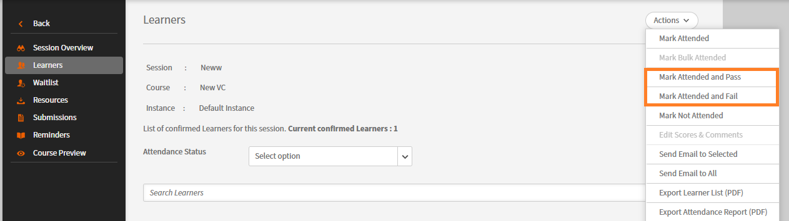

# Gerenciamento dos alunos da sua sessão

Leia esse artigo para saber como gerenciar os participantes e enviar e-mails e lembretes relacionados ao curso em suas sessões.

## Ver sessões ou módulos com revisões pendentes {#pending}

Como professor, você pode ver as sessões ou módulos com revisões pendentes.

Na página Sessões/Módulos, você pode ver uma coluna **Revisões pendentes** que mostra o número de revisões pendentes para a sessão/atividade correspondente.

## Gerenciar lista de espera da sua sessão {#managewaitlistforyoursession}

À medida que os alunos se registram no módulo, você pode ver o status mais recente da inscrição e da lista de espera na página Lista de espera.

1. No aplicativo do professor, selecione Próximas sessões > Lista de espera no painel de navegação à esquerda.

   Você pode visualizar o limite de vagas, o número de vagas preenchidas atualmente e o número de vagas livres. Uma tabela também lista os alunos que estão na lista de espera. Isso aparece em branco se não houver filas na lista de espera.

   
   *Exibir alunos na lista de espera*

1. Na tabela Lista de espera, selecione o aluno ou alunos que deseja confirmar.
1. Selecione Ações > Confirmar alunos.

   Os alunos que você confirmou são adicionados à lista Alunos confirmados.

Os professores têm a capacidade de cancelar a inscrição dos alunos nas sessões. Isso também cancela a inscrição dos alunos dos aprendizados correspondentes. Selecione a guia **[!UICONTROL Lista de espera]**. Selecione os alunos para cancelar a inscrição usando a caixa de seleção. Para cancelar a inscrição, selecione **[!UICONTROL Ações]** > **[!UICONTROL Cancelar inscrição dos alunos]**.

*Cancelar inscrição dos alunos*

### Relatório de lista de espera

O novo **[!UICONTROL Relatório de lista de espera]** do Adobe Learning Manager permite que os professores baixem a lista de alunos na lista de espera de todas as instâncias de um curso. Os professores podem acessar este relatório na seção **[!UICONTROL Lista de espera]** da página **[!UICONTROL Visão geral da sessão]**.

Seguindo as colunas disponíveis no relatório Lista de espera:

* Nome do curso
* Nome da instância
* ID da instância
* Status da instância
* Nome do usuário
* E-mail
* ID exclusiva do usuário
* Data da inscrição (fuso horário central da Europa)
* Status
* Número na lista de espera
* Limite de listas de espera
* Limite de vaga

Para baixar o relatório da seção Professor:

1. Faça logon como **[!UICONTROL professor]**.
2. Selecione qualquer sessão na página inicial.
3. Selecione a opção **[!UICONTROL Lista de espera]** na página **[!UICONTROL Visão geral da sessão]**.
4. Selecione **[!UICONTROL Ações]** > **[!UICONTROL Exportar relatório]** para baixar o relatório de **[!UICONTROL Lista de espera]**.

## Marcar a presença na sua sessão {#markattendanceforyoursession}

É possível ver o número de alunos confirmados que estão presentes na sessão, seus nomes, o status de presença dos alunos e outros detalhes da página Alunos.

1. No painel de navegação à esquerda, clique em Próximas sessões > Alunos.
1. Selecione o aluno ou os alunos na lista de participantes e execute um dos procedimentos a seguir:

   * Para marcar a presença, clique em Ações > Marcar presença. Uma vez que o status foi marcado como Presente, não é possível alterar o status.
   * Para marcar a ausência, clique em Ações > Ausente.
   * Para excluir um aluno devido ao cancelamento ou outros motivos, clique em Ações > Excluir alunos.

   Um aluno só pode terminar um módulo quando o status de comparecimento seja Presente.

   
   *Marcar participação do aluno*

### Baixar códigos QR para inscrição e participação do aluno

Os professores podem baixar códigos QR para suas sessões atribuídas a fim de permitir que os alunos se inscrevam em uma instância do curso e marquem a participação ou a conclusão digitalizando o código QR.

Isso permite que os professores gerenciem a participação na sessão de maneira independente, sem precisar de assistência do administrador.

As etapas a seguir são adequadas para:

* Sessões de sala de aula física
* Sessões de sala de aula online

Para uma sessão física de sala de aula, como professor, você tem de gerar o código QR correto e colá-lo na sala de aula (ou passá-lo) onde os alunos estão participando da sessão para que eles possam digitalizar o código QR e marcar sua inscrição ou participação ou ambos, dependendo do código QR.

Para uma sessão de sala de aula online, como professor, você pode enviar o código QR gerado por e-mail, um sistema de mensagens ou qualquer outro meio para que os alunos possam digitalizar o código QR e marcar sua inscrição ou participação ou ambos, dependendo do código QR.

#### Baixar QR Codes para uma sessão

1. Entre no Adobe Learning Manager com a função **Professor**.
2. Vá para o **Painel do professor**.
3. Abra a **instância do curso** relevante.
4. Selecione a guia **Sessões**.
5. Escolha uma sessão atribuída a você.
6. Selecione **QR Code da Sessão**.
   

Você pode baixar os seguintes códigos QR:

* **Código QR de inscrição** - permite que os alunos se inscrevam na instância do curso
* **Código QR de participação** - marca a participação na sessão
* **Inscrição + Código QR de Participação** - inscreve alunos e marca a participação em uma única verificação

O código QR é baixado como um PDF e pode ser compartilhado digitalmente ou exibido durante a sessão.

#### O que acontece quando os alunos digitalizam o código QR

* Os alunos digitalizam o código QR usando um dispositivo móvel.
* O Adobe Learning Manager valida o aluno e a sessão.
* Com base no tipo de código QR:
  * Os alunos estão inscritos na instância do curso ou
  * Presença e conclusão registradas para a sessão

Todas as atualizações são refletidas automaticamente nos registros, transcrições e relatórios do aluno.

#### Notas

* Os códigos QR estão disponíveis apenas para professores atribuídos à sessão.
* As regras de inscrição, participação e conclusão configuradas para o curso e a sessão continuam a ser aplicáveis.
* Os fluxos de trabalho existentes de progresso e relatórios do aluno permanecem inalterados.

#### Casos de uso

* As organizações que executam grandes volumes de sessões no local (por exemplo, treinamento de produtos para profissionais) podem permitir que os professores imprimam códigos QR específicos da sessão que se inscrevem e marcam presença com uma digitalização.

* No varejo, na fabricação e no treinamento de saúde, onde os alunos frequentemente participam das sessões diretamente do piso ou sem pré-inscrição, um código QR “Inscrever-se + Participar” pode ser colocado na porta. Isso permite que os alunos façam o autoatendimento da sua inscrição e da presença por meio de seus telefones.

* Os eventos de treinamento para parceiros ou clientes permitem que o instrutor no local se adapte facilmente a alterações na sala, sessões adicionais ou participantes extras sem precisar consultar o administrador para obter novos códigos QR.

### Convites do calendário {#calendarinvites}

* Quando um aluno ou professor está inscrito em uma sala de aula ou sessão de sala de aula virtual, o Learning Manager envia um convite da agenda (arquivo ICS).
* O convite do calendário inclui:

  * Data e hora da sessão
  * Detalhes da sessão
  * **Link de ingresso direto na sessão** na descrição do calendário

  

Os participantes podem abrir o evento do calendário e ingressar na sessão diretamente de seu calendário.

#### Ingressar em uma sessão do Gmail

1. Abra o **Calendário do Google**.
2. Selecione o evento da sessão.
3. Nos detalhes do evento, clique no **link de ingresso na sessão**.
4. A sessão é aberta diretamente no Adobe Learning Manager ou na ferramenta de sala de aula virtual configurada.

Não é necessário abrir o email original para acessar o link da sessão.

#### Ingressar em uma sessão de outros clientes de calendário

O link da sessão é incluído no corpo do evento do calendário e pode ser acessado em:

* Microsoft Outlook
* Apple Calendar
* Outros aplicativos de calendário que oferecem suporte a arquivos ICS

#### Notas

* Os convites do calendário são gerados automaticamente pelo Learning Manager.
* As informações de fuso horário no convite do calendário são ajustadas com base no fuso horário selecionado do aluno.
* Esse aprimoramento se aplica a convites de calendário recém-gerados.
* Nenhuma configuração adicional é exigida por administradores ou professores.

## Marcar sucesso para alunos

Os professores podem marcar o status de sucesso de cada aluno como Aprovado ou Reprovado diretamente na página Alunos. Esse recurso permite que os professores registrem com precisão o resultado das sessões de sala de aula ou sala de aula virtual com base no desempenho do aluno.

Para marcar o sucesso dos alunos:

1. Faça logon no Adobe Learning Manager como professor.
2. Selecione **[!UICONTROL Próximas sessões]** no painel de navegação à esquerda.
3. Selecione **[!UICONTROL Alunos]**.
4. Selecione os alunos e selecione **[!UICONTROL Ações]**.
5. Selecione qualquer uma das opções a seguir para marcar o sucesso dos alunos selecionados:

   * **[!UICONTROL Marcar Participou e Aprovado]**: alunos marcados como Aprovado concluíram o módulo com êxito.
   * **[!UICONTROL Marcar Participou e reprovado]**: alunos marcados como reprovados concluíram o módulo, mas não foram aprovados.

   
   _Página de alunos mostrando o menu Ações com as opções Marcar participação e Aprovar e Marcar participação e Reprovar destacadas para gravar os resultados do aluno_

6. Selecione **[!UICONTROL Sim]** no prompt de confirmação.

## Enviar e-mails aos alunos {#sendemailstolearners}

Você pode enviar e-mails a alunos específicos ou a todos os alunos da sua sessão. O recurso Enviar e-mail é muito útil se quiser confirmar a presença dos alunos ou se quiser enviar alguma comunicação em relação à sessão. Você também pode usar a opção Enviar e-mail a todos para enviar por e-mail a atribuição ou o material da sessão ou para fazer uma comunicação geral a todos os alunos.

Para enviar e-mails aos alunos, na página Alunos do aplicativo do professor, siga um destes procedimentos:

* Para enviar e-mails a participantes específicos, selecione o participante e clique em Ações > Enviar e-mail aos selecionados.
* Para enviar um e-mail a todos os participantes a fim de enviar material do curso ou uma atribuição, clique em Ações > Enviar e-mail a todos.

## Capturar respostas ao convite

Os professores podem capturar as respostas de convite dos alunos apenas quando a opção **[!UICONTROL Convidar resposta]** está habilitada pelo administrador do ACAP. Para habilitar este recurso, os administradores precisam entrar em contato com a equipe de suporte em [learningmanagersupport@adobe.com](mailto:learningmanagersupport@adobe.com).

Depois de concluído, você pode exibir as respostas aos convites na seção **[!UICONTROL Alunos]**. Vá para qualquer sessão, selecione **[!UICONTROL Alunos]** e selecione a resposta ao convite no menu suspenso.

## Exportar lista de alunos {#exportinglearnerslist}

Como professor, você pode marcar facilmente a presença de todos os seus alunos exportando a lista de participantes como um PDF. Para exportar a lista de participantes, vá para o painel esquerdo Aluno. Clique em Ações > Lista de alunos para exportação (PDF).

Depois que a lista de participantes da sua sessão é confirmada, você pode exportar a lista como PDF. Este PDF de fácil impressão exibe os alunos como uma tabela. Você pode marcar a presença ou fornecer pontuações, e fazer anotações ou fornecer notas aos alunos, tudo no mesmo PDF.

Observe um código QR no canto superior direito desta PDF. Essa funcionalidade permite que os alunos individuais digitalizem o código usando o aplicativo móvel do Learning Manager para marcar a presença deles.

*Digitalize o código QR para marcar a presença*

## Aprovar ou rejeitar envios {#approveorrejectsubmissions}

Se os alunos enviarem documentos como atribuições, relatórios ou avaliações para sua sessão, você pode visualizar os documentos na página Envios. Você pode usar os materiais para classificar o aluno, bem como aprovar ou rejeitar o envio.

1. No painel esquerdo, clique em Próximas sessões ou Sessões passadas, com base nos horários agendados da sessão.
1. Clique no curso para o qual você deseja ver os envios.

   No painel esquerdo, clique em Envios.

1. Você pode ver os envios dos alunos para a sessão que você selecionou. Selecione o envio que você deseja aprovar ou rejeitar e clique em Aprovar ou Rejeitar.

   O status de envio muda para Aprovado ou Rejeitado, com base na sua ação.

## Configurar lembretes para sua sessão {#configureremindersforyoursession}

1. No painel esquerdo, clique em Próximas sessões.
1. Clique no curso para o qual deseja exibir o lembrete. No painel esquerdo, clique em Lembretes.
1. No título Selecionar lembrete, clique em Definir lembrete.

   
   *Configurar lembretes para sua sessão*

1. Faça o seguinte:

   * Na caixa de diálogo Configurações do lembrete, defina a opção de quando enviar o lembrete aos alunos: Antes do prazo, No prazo ou Após o prazo.
   * No campo de dias antes do prazo, defina o número de dias antes do prazo para enviar o lembrete aos alunos.
   * Defina a recorrência do lembrete.

   
   *Exibir configurações de lembrete*

1. Siga um destes procedimentos:

   * Clique na marca de verificação para salvar o lembrete.
   * Clique na marca de cruz para cancelar o lembrete.

   Um lembrete automatizado do curso é enviado a todos os alunos na data definida indicada nas configurações do lembrete.

   Se já tiver definido lembretes para suas sessões, poderá visualizá-los no campo Lembretes existentes. Além disso, você também pode adicionar lembretes extras aos seus lembretes existentes.

   Para excluir um lembrete existente, clique no lembrete. Na janela pop-up exibida, clique no ícone Excluir (ícone de lixeira) para excluir o lembrete.

## Criar e gerenciar equipes no Adobe Learning Manager

Crie equipes manualmente dos alunos em uma instância do curso e adicione, mova, remova, renomeie ou exclua equipes até que uma equipe seja bloqueada.

Como professor, você cria equipes para cada instância de um curso que tem um módulo de envio com base em equipes. Qualquer professor atribuído à instância pode gerenciar suas equipes. O Adobe Learning Manager também pode criar equipes automaticamente. Depois que as equipes são formadas, os alunos podem enviar trabalhos e você pode avaliar os envios à equipe.

### Abrir a página de gerenciamento de equipes

1. No aplicativo do professor, selecione **Equipes** no painel de navegação esquerdo. A página lista as instâncias do curso baseado em equipe às quais os alunos estão atribuídos.

   

1. Para localizar um curso, procure-o ou classifique a lista pela data da última atualização.

1. Selecione a instância do curso. A página de instância mostra os alunos não atribuídos e as equipes.

### Criar equipes com uma regra

1. Na página da instância, selecione os alunos não atribuídos para dividir em equipes.

1. Escolha uma regra. Selecione **Ação** > **Formar uma única equipe** ou **Formar várias equipes**.

   

1. Se você selecionar **Formar várias equipes**, insira o número de alunos de cada equipe. O valor deve ser 1 ou superior. A página mostra quantas equipes serão criadas. Por exemplo, com 94 alunos e 2 alunos por equipe, 47 equipes são criadas. Se o número for maior que o número de alunos inscritos, uma mensagem de erro será exibida. Insira um número menor.

   

   Se você inserir um valor maior que o número de alunos inscritos, uma mensagem de erro será exibida.

   

1. Selecione **Criar equipes**. As equipes aparecem na guia **Equipes**.

   

1. Confirme e salve. As equipes aparecem na guia **Equipes**.

A regra se aplica somente aos alunos não atribuídos selecionados. Para reagrupar todos, exclua as equipes existentes primeiro. Seus alunos retornam à lista não atribuída.

Depois de selecionar **Excluir**, você obtém a seguinte caixa de diálogo de confirmação:

Selecione **Excluir equipes**. Todos os alunos retornam à lista não atribuídos.

### Criar um único grupo

1. Selecione os alunos não atribuídos a serem incluídos na equipe.

1. Selecione **Ação** > **Formar uma única equipe**. Uma equipe é criada com o número especificado de alunos.

   

1. Salve a equipe. Uma equipe precisa de pelo menos um aluno e um aluno pode pertencer a apenas uma equipe na instância.

1. Repita as etapas para criar equipes uma a uma.

### Adicionar alunos a uma equipe existente

1. Selecione os alunos não atribuídos a serem adicionados.

1. Escolha para atribuí-los a uma equipe existente e, em seguida, selecione a equipe.

   

1. Confirme sua escolha. Selecione **Atribuir Aluno**.

### Mover ou remover alunos

1. Abra a guia **Equipes** e expanda uma equipe para exibir seus membros.

1. Selecione os alunos que deseja mover.

   

1. Escolha para movê-los e, em seguida, selecione a equipe de destino.

1. Para remover um aluno de uma equipe, selecione-o e remova-o. O aluno retorna à lista não atribuída.

Quando uma equipe não tem mais alunos, ela é excluída automaticamente.

### Renomear um grupo

1. Na guia **Equipes**, selecione a equipe e escolha renomeá-la.

1. Selecione **Ação** > **Renomear**.

   

1. Insira um nome exclusivo, como Alpha de grupo.

   

1. Selecione **Renomear equipe**.

Nomes não podem ser repetidos e você não pode usar o formato gerado pelo sistema, como Team-1.

### Excluir equipes

1. Na guia **Equipes**, selecione uma ou mais equipes.

1. Selecione **Ação** > **Excluir**.

1. Selecione **Excluir equipe**.

   

1. Confirmar. Os alunos das equipes excluídas retornam à lista não atribuídas.

### Tratar inscrições atrasadas e cancelamentos de inscrição

* Um aluno que se inscreve após a formação de equipes aparece na lista não atribuída. Adicionar o aluno a uma equipe.
* Se todas as equipes estiverem bloqueadas, crie uma nova equipe para o aluno.
* Um aluno que cancela a inscrição é removido da equipe automaticamente. O grupo continua e um grupo vazio é excluído.

### Solução de problemas

**Não é possível selecionar uma equipe ou mover seus membros.** Um grupo é bloqueado após o primeiro envio, e o bloqueio se aplica a todos os módulos do grupo na ocorrência. Para desbloquear a equipe, cancele o envio. Exibir **Avaliar e cancelar o envio de envio à equipe**.

**Não é possível renomear uma equipe.** O nome já está em uso ou corresponde ao formato gerado pelo sistema. Insira um nome diferente.

**Um erro aparece ao criar equipes.** Uma equipe não pode ter mais de 100 membros. Reduza o número de membros por equipe.

**Não é possível abrir o gerenciamento de equipes para uma instância.** A criação automática de equipes pode estar em execução. O acesso retorna quando termina.

**O salvamento foi rejeitado e a página foi recarregada.** Outro professor ou a tarefa automática salvou alterações primeiro. Revise as equipes atualizadas e refaça sua alteração.

**Uma equipe desapareceu.** Uma equipe sem alunos é excluída automaticamente.

## Avaliar e cancelar o envio à equipe

Revise o arquivo enviado de uma equipe, conclua o plano de avaliação, aprove ou rejeite o trabalho ou cancele o envio para que a equipe possa enviar novamente.

Quando você avalia um envio de equipe, o resultado se aplica a todos os membros da equipe e cada membro recebe uma notificação. Somente professores atribuídos à instância podem avaliar. As etapas são as mesmas para envios individuais, exceto que os envios individuais não têm detalhes da equipe. Verifique se os grupos existem primeiro. Exibir **Criar e gerenciar equipes**.

Equipes que foram formadas automaticamente podem ser editadas da mesma forma que as equipes manuais.

### Localizar um envio

1. No aplicativo do professor, abra a área de envios e selecione **Envios de equipe**. Selecione **Envios individuais** para módulos de aluno único.

1. Para localizar um módulo, pesquise por nome de sessão ou módulo.

1. Selecione o nome do módulo.

   

1. Para restringir a lista, filtre por status: **Envio pendente**, **Revisão pendente**, **Aprovado**, **Rejeitado** ou **Concluído**.

1. Para exibir os membros da equipe, expanda a equipe. Nomes e endereços de e-mail são exibidos, e o aluno que enviou o arquivo tem uma tag **Remetente**.

1. Para baixar o arquivo enviado, selecione a opção de download para a equipe.

### Avaliar um envio

1. Localize a equipe com o status de **Revisão pendente**.

1. Abra o arquivo enviado e revise o conteúdo.

1. Selecione **Ação** > **Avaliar**.

   

1. Conclua o plano de avaliação:

   * Responda a todas as perguntas necessárias.
   * Para perguntas de objetivo, selecione uma opção. Com a pontuação baseada em critérios, a pontuação é atualizada conforme você seleciona.
   * Para perguntas subjetivas, insira sua resposta.
   * Se forem permitidas observações, acrescentar observações à pergunta ou à avaliação na sua totalidade.

   

1. Se o módulo exigir aprovação do revisor, selecione **Aprovar** ou **Rejeitar**. Adicione um comentário ao rejeitar para que a equipe saiba o que corrigir.

   

1. Se o módulo usar pontuação manual, insira a pontuação geral.

   

   **Opcional**: insira uma nota particular selecionando a opção **Adicionar uma nota particular à pontuação**. Uma observação privada é visível somente para professores atribuídos à instância. Os alunos não podem visualizá-lo, mesmo quando você seleciona **Mostrar comentário**.

1. Envie a avaliação. Selecione **Enviar**. O status de envio é alterado para **Aprovado**.

   

Outros professores também podem avaliar o mesmo envio, desde que ainda não tenha sido aprovado. Uma avaliação posterior substitui uma anterior até que a submissão seja aprovada.

Se o módulo não exigir a aprovação do revisor, ele será concluído para todos os membros da equipe quando a equipe enviar. Somente a opção de envio é exibida e você não poderá editar a pontuação ou os comentários depois disso.

Depois de aprovar ou rejeitar o envio de uma equipe, um aluno pode visualizar o status do envio e o resultado da avaliação.

Selecionar o resultado da avaliação exibe os parâmetros e comentários de avaliação do professor.

## Revisar ou alterar uma avaliação

1. Encontrar uma equipe com o status **Rejeitado**.

1. Para abrir a avaliação concluída, selecione **Exibir avaliação**.

1. Para avaliar novamente, selecione a opção reavaliar e envie suas alterações. Você pode fazer isso apenas para envios rejeitados. **Os envios aprovados não podem ser alterados**.

### Cancelar envio

Cancele o envio quando a equipe precisar enviar novamente, quando a avaliação precisar começar de novo ou quando precisar alterar uma equipe bloqueada. Para uma submissão individual, você também pode usar isso para corrigir uma avaliação informada para o aluno errado.

1. Encontre uma equipe ou aluno que tenha um envio.

1. Selecione **Cancelar Envio**.

   

1. Insira seus comentários e selecione **Cancelar envio**.

   

O envio é removido e o status retorna para **Envio pendente**. A equipe é desbloqueada para que você possa editar seus membros. Os membros da equipe recebem uma notificação e um email. Qualquer membro pode enviar novamente e o novo arquivo substitui o anterior. Sua nova avaliação substitui a avaliação anterior e nenhum histórico é mantido.

Não é possível cancelar o envio de um membro da equipe após a conclusão do curso, pois a conclusão não pode ser revertida.