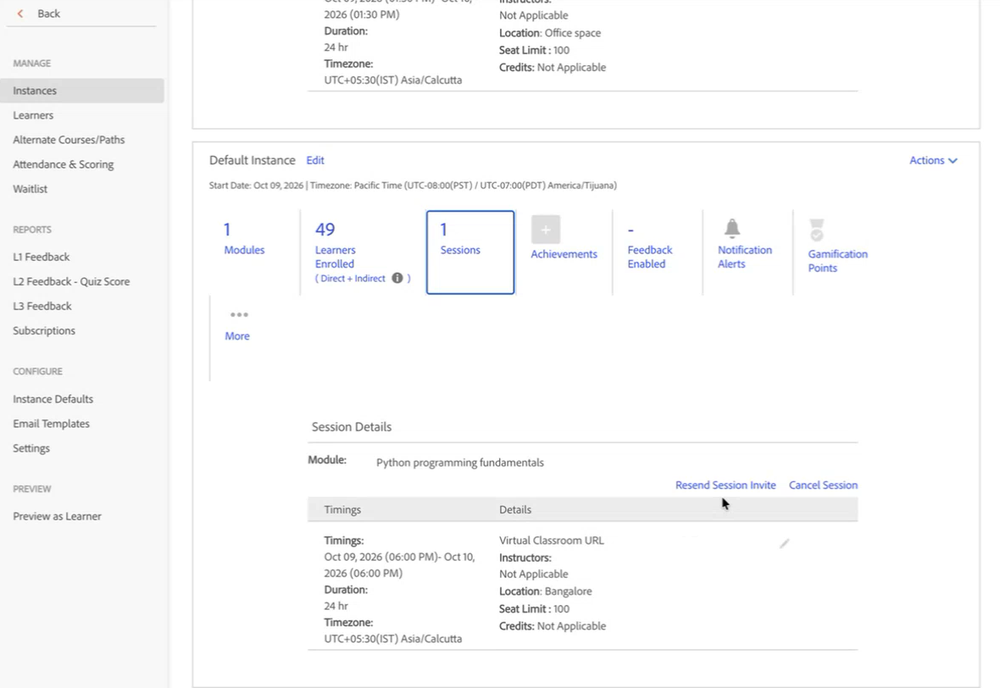
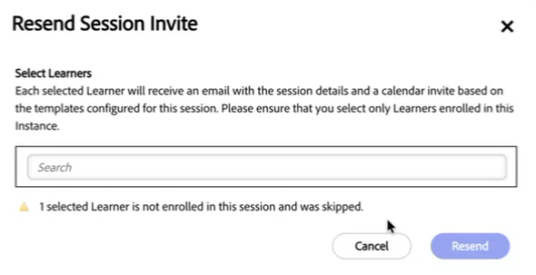
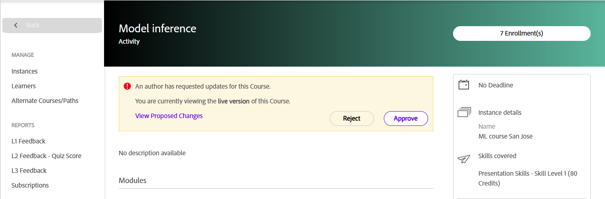

# Reenviar convites de sessão

## Visão geral

>[!NOTE]
>
>A reativação está disponível somente para sessões de sala de aula virtual (SV). Outros tipos de módulos, como sala de aula e ritmo individualizado (e-learning), não são compatíveis.

Os alunos podem perder um convite por vários motivos. Com a opção **Reenviar**, como administrador com permissão para editar cursos, você pode abrir uma sessão de sala de aula virtual na página da instância, procurar os alunos e enviar o email de convite da sessão. O Learning Manager envia o e-mail por demanda, fora do fluxo de evento de inscrição. O aluno recebe os detalhes da sessão e um convite da agenda, e o estado de inscrição permanece o mesmo.

## Casos de uso

Veja a seguir os casos de uso em que você reenviaria um convite de sessão.

* **Recuperar um convite perdido.** Reenvie o convite para um aluno cuja caixa de correio estava cheia, cujo e-mail foi enviado para spam ou cujo e-mail original não foi entregue.
* **Reduzir não apresentação.** Reenvie os detalhes da sessão e o convite do calendário imediatamente antes da sessão ou no dia da sessão.
* **Evite soluções alternativas de inscrição.** Reenvie um convite sem cancelar a inscrição e reinscrever o aluno para que o estado de inscrição e o registro da sessão permaneçam intactos.
* **Reduza tíquetes de suporte.** Os administradores resolvem eles próprios as solicitações de “convite ausente”, sem envolver a equipe de suporte.

## Pré-requisitos

* A sessão é uma sessão VC.
* O aluno está inscrito na sessão de destino. O Learning Manager envia o convite somente aos alunos inscritos na sessão.
* A sessão já existe. Este recurso não cria nem modifica sessões.
* O modelo de email de Convite de Sessão existente é usado. Este recurso não apresenta um novo modelo de email.

## Configurações compatíveis

| Item | Suporte |
|--------------------|-----------------------------------------------------------------------------------------------------------|
| Funções | Administradores com permissão para editar o curso. Professores para as sessões às quais estão atribuídos. |
| Tipos de item de catálogo | Cursos e programações de aprendizado |
| Tipo de módulo | Sessões de sala de aula virtual (SV) |
| Sessões | Sessões atuais e futuras. As sessões anteriores não são compatíveis. |
| Provedores de VC | Todos os provedores configurados para a sessão, como Zoom, Equipes e Adobe Connect |
| Modelos de e-mail | Os modelos configurados para o objeto de aprendizado: uma sessão detalha o e-mail e um convite do calendário |
| Destinatários | Alunos individuais inscritos na sessão. Não há suporte para grupos de usuários. |
| Acionador | Manual, na ação Reenviar convite da sessão |

A função Gerente não tem acesso a esse recurso nesta versão. A opção está oculta para alunos e gerentes.

## Acessar a ação de convite para reenviar sessão

O local da ação depende da sua função.

| Função | Onde encontrar a ação |
|---------------|-----------------------------------------------------------------------------------------------------------------------------------------------------------------------------------------------------------------|
| Administrador | Abra o curso ou caminho de aprendizado no catálogo, vá para Instâncias e abra a instância. Na seção Sessões, localize a sessão de aula virtual e selecione Reenviar convite de sessão. Você precisa de permissão para editar o curso. |

## Caixa de diálogo Reenviar

A caixa de diálogo Reenviar convites de sessão contém os seguintes elementos.

| Elemento | Descrição |
|-----------------|---------------------------------------------------------------------------------------------------------------------------------------------------------------------------------------------------------------------------------------------------------------------------------------------------------------------------|
| Selecionar alunos | Um campo de pesquisa. Insira o nome ou o endereço de e-mail de um aluno para localizá-lo e, em seguida, selecione-o. Você pode selecionar mais de um aluno. Uma nota explica que cada aluno selecionado recebe dois e-mails: um e-mail de detalhes da sessão e um convite do calendário, com base nos modelos configurados para o objeto de aprendizado. |
| Cancelar | Fecha a caixa de diálogo sem enviar emails. |
| Reenviar | Envia os e-mails para os alunos selecionados. O botão fica desativado até você selecionar pelo menos um aluno. |

>[!NOTE]
>
>A pesquisa corresponde apenas a alunos individuais. Não é possível pesquisar ou selecionar grupos de usuários.

## Reenviar um convite de sessão

Conclua as etapas a seguir como administrador.

1. Faça logon como um administrador que tenha permissão para editar o curso.
2. Navegue até **Aprendizado** > **Cursos**.

   

3. Abra o curso cujas instâncias você deseja acessar.

   

4. Navegue até a instância cuja sessão você deseja acessar.
5. Na seção **Detalhes da Sessão** abaixo, selecione **Reenviar Convite de Sessão**.

   

6. O pop-up **Reenviar Convite de Sessão** é aberto.

   

7. Procure o aluno ou os alunos para os quais deseja reenviar o convite.

   

   

8. Selecione **Reenviar**. Você verá uma mensagem indicando “Convite de sessão enviado para “x” alunos.”

   

9. Caso um dos alunos selecionados seja de outra sessão, você verá uma mensagem que diz: “X aluno selecionado não está inscrito nesta sessão e foi ignorado”.

   

10. Após alguns minutos, os alunos receberão um e-mail com os detalhes da sessão, incluindo um link para ingressar na sessão.

O Learning Manager confirma que cada aluno selecionado está inscrito na sessão de destino e envia o convite da sessão existente aos alunos qualificados.

Quando o Learning Manager aceita a solicitação, a caixa de diálogo é fechada e uma mensagem de confirmação é exibida: “Os e-mails de convite estão sendo enviados aos alunos para a sessão. Isso pode levar algum tempo para ser concluído.” Os e-mails geralmente chegam em poucos minutos.

## Conteúdo de email

Cada aluno selecionado recebe o e-mail de detalhes da sessão e o convite do calendário da sessão. O conteúdo inclui o link de ingresso da sessão de sala de aula virtual, a data e a hora e os detalhes da sessão. O e-mail é o mesmo do convite da sessão original, pois o Learning Manager usa o mesmo modelo.

## Comportamento de várias inscrições

O reenvio é específico para uma instância. Se um aluno estiver inscrito em mais de uma instância, o reenvio de uma instância enviará o convite apenas para essa instância. Isso não aciona novamente os convites para outras instâncias do aluno.

| Inscrição do aluno | Ação | Resultado |
|------------------------------------------------|------------------------------------------------|----------------------------------------------------------------------------------|
| Instância A e Instância B | Reenviar da Instância A | Somente a Instância A do convite é reenviada. |
| Somente Instância A | Reenviar da Instância A | A Instância A convite é reenviada. |
| Uma instância diferente da sessão selecionada | O aluno aparece na pesquisa no nível do curso | O Learning Manager ignora o aluno da sessão selecionada e mostra um aviso. |

## Comportamento em cenários específicos

| Cenário | Comportamento |
|--------------------------------------------------------|------------------------------------------------------------------------------------------------------------------------------------------------------------------------------------------------------------------------------|
| A instância não tem sessões de aula virtual | A ação Reenviar convite da sessão não está disponível. |
| A sessão já ocorreu | Ação indisponível. O Learning Manager oferece suporte somente a sessões atuais e futuras. |
| Você seleciona um aluno que não está inscrito na sessão | A pesquisa do aluno abrange todo o curso, para que você possa encontrar alunos de outras instâncias. O Learning Manager ignora os alunos que não estão inscritos na sessão selecionada, envia o convite para os outros e mostra um aviso. |
| Um aluno está inscrito em várias instâncias | O Learning Manager envia o convite somente para a instância da qual você o enviou. Ele não envia convites para as outras instâncias. |
| Uma instância do caminho de aprendizado está selecionada | A ação funciona da mesma maneira que para uma instância do curso. |

## Manipulação de erros

Se um erro impedir o Learning Manager de enviar os e-mails, a caixa de diálogo mostrará uma das seguintes mensagens.

| Condição | Mensagem |
|---------------------------------------|------------------------------------------------------------------------|
| O modelo de email de convite está desativado | Não é possível enviar e-mail: o modelo de e-mail de convite está desativado no momento. |
| Qualquer outro erro | Ocorreu um erro ao enviar o email. Tente novamente mais tarde. |

Se você selecionar alunos que não estão inscritos na sessão, o Learning Manager mostra um aviso de que o convite foi ignorado para esses alunos. Isso ainda envia o convite para os alunos inscritos.

>[!NOTE]
>
>O serviço de e-mail relata o status da entrega para o Learning Manager de forma assíncrona, após a caixa de diálogo ter sido fechada.

## Limitações

* Você pode reenviar convites apenas para as sessões atuais e futuras.
* Somente os modelos configurados para o objeto de aprendizado são usados. Você não pode selecionar um modelo diferente.
* Você pode reenviar convites para uma sessão de cada vez. Não há suporte para o reenvio em várias instâncias de uma só vez.
* Você não pode selecionar grupos de usuários. Você pode selecionar apenas alunos individuais.
* O Learning Manager envia convites apenas aos alunos inscritos na sessão selecionada.
* A caixa de diálogo não mostra o status de entrega dos e-mails e não oferece uma nova tentativa para alunos individuais.
* Não é possível agendar novas sessões ou editar detalhes de sessões existentes na caixa de diálogo.

## Solução de problemas

| Sintoma | Causa provável | Ação |
|---------------------------------------------------------------------|-------------------------------------------------------------------------------------------------------------------|---------------------------------------------------------------------------------------------------------------------|
| A ação Reenviar convite da sessão não está visível | O módulo não é uma sessão de sala de aula virtual, a sessão já ocorreu ou você não tem permissão para editar o curso. | Confirme se a sessão é uma sessão de aula virtual atual ou futura. Peça a um administrador para verificar as permissões do curso. |
| Um aviso é exibido após você enviar os emails | Um ou mais alunos selecionados não estão inscritos na sessão selecionada. | Verifique quais alunos estão inscritos na sessão e reenvie o convite da sessão ou instância correta. |
| O convite foi enviado para a instância errada | O aluno está inscrito em várias instâncias e você reenvia o convite de uma instância diferente. | Abra a instância de que o aluno precisa e reenvie o convite a partir daí. |
| O erro “o modelo de email de convite está desativado no momento” é exibido | O modelo de e-mail de convite está desativado para o objeto de aprendizado. | Peça a um administrador para ativar o modelo e reenvie o convite. |
| O email atual tem a mesma aparência do convite original | Isso é esperado. O Learning Manager reutiliza o modelo de convite de sessão existente. | Nenhuma ação é necessária. |
| Você precisa reenviar convites em várias instâncias ao mesmo tempo | Não há suporte para este item. | Reenvie os convites de cada instância separadamente. |
| Você precisa reenviar um convite para uma sala de aula ou um módulo de e-learning | Não há suporte para este item. A reinicialização está disponível somente para sessões de aula virtual. | Nenhuma ação está disponível para esses tipos de módulo. |
| Um aluno diz que o e-mail não chegou | O e-mail ainda está sendo processado, a caixa de correio do aluno está cheia ou o e-mail foi filtrado como spam. | Aguarde alguns minutos, peça ao aluno para verificar a pasta de spam e liberar espaço na caixa de correio e, em seguida, reenvie o convite. |
