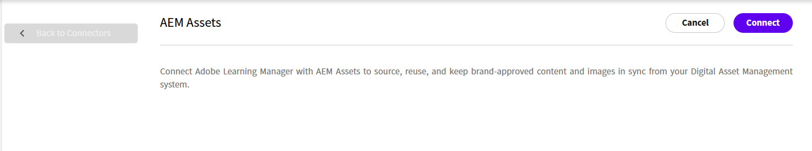
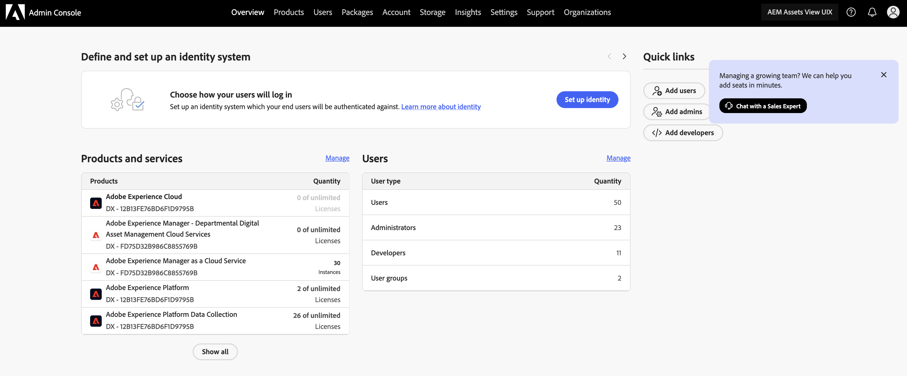

# Integração de ativos AEM

## Visão geral

O Adobe Learning Manager agora se integra ao Adobe Experience Manager Assets as a Cloud Service. As equipes podem armazenar conteúdo de aprendizado e imagens no Adobe Experience Manager Assets, importá-los para o Adobe Learning Manager e gerenciar atualizações em um só lugar. Quando um ativo é alterado, o conteúdo vinculado na Biblioteca de conteúdo pode ser atualizado automaticamente, de modo que os autores não precisam fazer upload dos arquivos novamente.

Como sua organização gerencia ativos em um só lugar, os autores usam arquivos atuais aprovados pela marca em vez de baixar e reenviar cópias. O Adobe Experience Manager Assets também mantém o histórico de versões de cada arquivo, o que fornece um registro de qual versão estava ativa e quando.

A configuração é uma tarefa única, e é a parte que precisa de mais cuidado. Após a configuração, a importação de ativos funciona como qualquer outro upload.

>[!NOTE]
>
>Essa integração está disponível para todas as contas do Adobe Learning Manager que têm uma licença do Adobe Experience Manager Assets, incluindo contas do Prime e Ultimate. A mesma documentação se aplica a ambos.

## Quem faz o quê

| Função | O que eles fazem |
|---|---|
| Administrador de integração do ALM | Conecta a conta e escolhe as configurações de integração. |
| Administrador do Adobe Admin Console | Atribui a conta técnica gerada aos perfis de produto corretos da AEM Assets. |
| Administrador do ALM | Importa imagens de vários locais usando a integração. |
| Autor do ALM | Importa conteúdo e imagens e cria cursos. |

Cada função tem uma parte separada na configuração e no uso da integração.

## Implantações compatíveis

| Item | Compatível |
|---|---|
| Adobe Experience Manager Assets as a Cloud Service, instância do autor | Sim |
| Instância de as a Cloud Service, publicação ou entrega do Adobe Experience Manager Assets | Não |
| Adobe Experience Manager local | Não |

>[!NOTE]
>
>O Adobe Learning Manager se conecta a instâncias do autor apenas porque os ativos são criados e gerenciados lá. O Publish e as instâncias de entrega não fazem parte da integração atual.

## Configurar a integração

Conecte o Adobe Learning Manager ao Adobe Experience Manager Assets, atribua a conta técnica e escolha as configurações de atualização.

Este fluxo de trabalho é para administradores de integração. Conclua todas as etapas para que as atualizações automáticas funcionem para os autores. A configuração tem cinco partes: conectar à organização do IMS, encontrar a conta técnica, atribuí-la no Adobe Admin Console, escolher as configurações e conceder acesso aos autores.

### Pré-requisitos {#setup-prerequisites}

Você deve atender a todos esses requisitos. Faltar um deles é o motivo mais comum de uma conexão falhar.

* Você tem a função de administrador de integração no Adobe Learning Manager. O fluxo de trabalho de conexão está disponível somente para esta função.
* Você é um administrador da organização do IMS para a organização do Adobe Identity Management System (IMS) selecionada.
* Você tem acesso a pelo menos uma organização na qual instâncias do AEM Assets podem ser associadas ao Learning Manager.

Se você não for um administrador da organização do IMS, peça ao administrador de TI para conceder acesso ou executar a conexão com você.

### Como o Adobe Learning Manager mapeia para sua organização do IMS

Cada conta do Adobe Learning Manager se conecta a uma organização do IMS (também chamada de perfil do IMS). Lembre-se do seguinte ao planejar sua configuração:

* Uma organização do IMS pode conter vários programas e ambientes, e cada programa pode ter instâncias do Adobe Experience Manager Assets. Você pode usar qualquer uma dessas instâncias com a conta conectada.
* Instâncias em uma organização IMS diferente não podem ser usadas com essa conta.
* Uma organização do IMS vinculada a uma conta da Adobe Learning Manager não pode ser vinculada a outra conta ao mesmo tempo.

>[!NOTE]
>
>Se a sua empresa tiver mais de uma organização do IMS, escolha a que contém sua licença do Adobe Experience Manager Assets e as instâncias que deseja que os autores usem.

### Conectar-se à sua organização do IMS

1. Faça logon no Adobe Learning Manager como **Administrador de Integração**.
1. Selecione **Adobe Experience Manager Assets** como o tipo de conector.

   

1. Selecione **Conectar**.

   

1. Faça logon com a Adobe ID quando solicitado e selecione a organização do IMS que contém as instâncias da Adobe Experience Manager Assets.

   

   

Em seguida, o Adobe Learning Manager verifica a função Administrador da organização IMS e o acesso à instância. Se ambas as verificações forem aprovadas, ela vinculará sua conta à conta do IMS já criada com o escopo da API do AEM Assets Author à organização do IMS selecionada e criará uma conta técnica para sua organização. A página de visão geral da conexão é aberta e mostra os detalhes técnicos da conta.

### Encontre a conta técnica

A conta técnica é criada especificamente para a sua organização. O Adobe Learning Manager a usa para ler ou gravar usando a [API Aberta](https://developer.adobe.com/experience-cloud/experience-manager-apis/api/experimental/assets/author/) do AEM Assets em segundo plano.

1. Faça logon como **Administrador de Integração** e abra a página de visão geral da conexão do **Adobe Experience Manager Assets**.
1. Na seção **Credenciais**, localize o **email da conta técnica**.
1. Copie o e-mail da conta técnica. Você a usará para localizar a conta no **Adobe Admin Console**.

### Atribuir a conta técnica no Adobe Admin Console

Adicione a conta técnica a um perfil de produto para cada instância do Adobe Experience Manager Assets que você deseja que o Adobe Learning Manager use. Por exemplo, se você tem 10 instâncias e deseja que apenas 6 delas funcionem com o Adobe Learning Manager, atribua a conta aos perfis dessas 6 instâncias.

1. Entre no **Adobe Admin Console** como administrador da mesma organização do IMS.
2. Selecione **Produtos e serviços** e selecione **Adobe Experience Manager as a Cloud Service**.

   

3. Selecione a instância que deseja usar com o Adobe Learning Manager.

   

4. Abra o perfil de produto que tem o acesso necessário ao Adobe Learning Manager. Por exemplo, o perfil de Administradores de AEM.

   

5. Selecione **Adicionar credenciais de API**.

   

6. Procure a conta técnica. Corresponda-o ao e-mail da conta técnica que você copiou do administrador de integração. A conta geralmente está na parte inferior da lista.

   

7. Selecione a conta técnica e, em seguida, selecione **Salvar**.
8. Repita as etapas de 3 a 7 para cada instância que deseja usar.

Se a lista de credenciais de API do perfil estiver vazia, a conta técnica ainda não foi atribuída. Para saber mais sobre perfis de produto e credenciais de API, consulte a documentação da Adobe Admin Console.

>[!IMPORTANT]
>
>Não ignore esta etapa. Se você não atribuir a conta técnica, os autores ainda poderão importar ativos do Adobe Experience Manager Assets, mas as atualizações automáticas não funcionarão. Em seguida, você deve atualizar o conteúdo manualmente.

### Escolher as configurações de integração

Depois de se conectar, habilite a conexão e escolha como o Adobe Learning Manager lida com atualizações e visualizações.

| Configuração | O que ela faz |
|---|---|
| Atualizações automáticas | Atualiza itens vinculados da Biblioteca de conteúdo quando o ativo é alterado no Adobe Experience Manager Assets. |
| Atualizar para objetos de aprendizado | Também aplica a atualização aos objetos de aprendizado que usam o item Biblioteca de conteúdo. |
| Link de visualização pública | Cria um link de visualização do conteúdo compatível e o salva nos metadados do ativo no AEM Assets. |

A atualização do objeto de aprendizado é uma configuração secundária de atualizações automáticas. Ela só pode ser ativada se as atualizações automáticas forem ativadas primeiro. Se você desativar as atualizações automáticas, os autores atualizarão o conteúdo manualmente na Biblioteca de conteúdo.

>[!IMPORTANT]
>
>As alterações nessas configurações, incluindo a desativação, podem levar até uma hora para entrar em vigor. O mesmo se aplica depois que você habilita a conexão. O atraso não significa que algo está errado. Espere até uma hora antes de testar.

### Conceder aos autores acesso ao Adobe Experience Manager Assets {#give-authors-access}

Configurar a integração não concede aos autores acesso aos seus ativos. Cada autor ou administrador do Adobe Learning Manager que importa ativos também deve ter acesso à instância correspondente do autor do Adobe Experience Manager Assets.

* Adicione autores como usuários da instância de autor do Adobe Experience Manager Assets, na mesma organização do IMS.
* Dê a eles pelo menos o acesso necessário para procurar e selecionar ativos. O administrador do Adobe Experience Manager decide quais funções e perfis de produto usar.

>[!NOTE]
>
>Conceder esse acesso é sua responsabilidade como administrador do Adobe Experience Manager. A Adobe Learning Manager não prescreve uma função específica. Para obter ajuda com usuários e perfis, consulte a documentação da Adobe Experience Manager Assets.

### Verificar a configuração

1. Aguarde o atraso das configurações descrito acima passar.
1. Faça logon como autor com acesso à instância.
1. Na **Biblioteca de Conteúdo**, selecione **Procurar** e confirme se a **AEM Assets** aparece ao lado do **Dispositivo**.
1. Importe um ativo e confirme se ele é importado.
1. Se o ativo for substituído ou for uma nova versão ou for reprocessado, ele será atualizado em poucos minutos na maioria dos casos ou, em casos raros, pode levar até uma hora. Se levar mais de uma hora, você poderá reprocessar o ativo no AEM Assets.

## Importar conteúdo do Adobe Experience Manager Assets

Importe conteúdo de aprendizado e imagens do Adobe Experience Manager Assets e crie cursos com base em conteúdo que esteja atualizado.

Este fluxo de trabalho é para Autores. O administrador de integração deve configurar a integração primeiro.

### Pré-requisitos {#import-prerequisites}

* O administrador de integração conectou a conta e ativou a conexão.
* Você tem acesso à instância do autor do Adobe Experience Manager Assets que mantém seus ativos na organização do IMS conectada. O administrador do Adobe Experience Manager concede esse acesso. Consulte [Conceder aos autores acesso ao Adobe Experience Manager Assets](#give-authors-access).

Depois que a integração estiver habilitada, qualquer opção de upload no Adobe Learning Manager que a suporte mostrará duas fontes: Dispositivo e AEM Assets. Isso inclui a biblioteca de conteúdo e as opções de upload de imagens do curso. O dispositivo permanece disponível, assim você ainda pode carregar arquivos do seu computador.

### De onde você pode importar

A opção AEM Assets é exibida nos locais de upload que dão suporte a ele. O upload do dispositivo permanece. Você pode importar:

* Conteúdo do módulo da Biblioteca de conteúdo.
* Imagens, como imagens de capa de curso e imagens de banner.
* Ajudas de tarefa

Apenas os tipos de arquivo compatíveis nesse local de upload são exibidos. Por exemplo, a opção de imagem de capa mostra apenas imagens. Os tipos compatíveis incluem imagens (JPEG, PNG, SVG), vídeo (MP4) e documentos (PDF, pacotes SCORM, PowerPoint e Word). As extensões de arquivo e os limites de tamanho são os mesmos de outros uploads nesse local.

### Conteúdo e imagens são tratados de forma diferente

| Item | Como é tratado |
|---|---|
| Conteúdo na Biblioteca de Conteúdo | Copiado e vinculado ao ativo de origem para que possa ser atualizado automaticamente. |
| Imagens, como imagens de capa e banner | Copiado quando você os seleciona. Eles não são vinculados e não são atualizados automaticamente. |

### Importar conteúdo para a Biblioteca de conteúdo

1. Abra a **Biblioteca de Conteúdo** e adicione conteúdo.
1. Selecione **Procurar**.
1. Selecione **AEM Assets**.
1. Se solicitado, faça logon com sua Adobe ID.
1. Na janela **Adobe Experience Manager Assets**, navegue até o ativo. Se você tiver acesso a mais de um repositório (instância do AEM ativada com o AEM Assets), alterne entre eles conforme necessário.
1. Selecione o ativo e conclua o upload e salve.
1. Crie seu curso usando o grupo de conteúdo.

Lembre-se do seguinte:

* Selecione um ativo de cada vez. A importação em massa e a importação de pastas não estão disponíveis e você não pode migrar uma biblioteca de conteúdo existente para o Adobe Experience Manager Assets.
* O seletor de ativos permite abrir um ativo no Adobe Experience Manager Assets.
* O Adobe Learning Manager não fornece conteúdo diretamente do Adobe Experience Manager Assets. Ele copia cada ativo importado e mantém uma cópia local.
* O conteúdo importado é processado como qualquer outro conteúdo no Adobe Learning Manager, incluindo a transcrição para o Assistente do aluno.

### Adicionar ajudas de tarefa

Selecione arquivos de ajuda de tarefa, como PDF e documentos de referência, no AEM Assets da mesma maneira que você importa o conteúdo da Biblioteca de conteúdo.

### Autores sem acesso

Se um autor não tiver acesso ao Adobe Experience Manager Assets para a organização do IMS conectada, ele verá uma mensagem sobre seu acesso limitado ao selecionar o AEM Assets.

## Manter conteúdo atualizado

Mantenha os itens vinculados da Biblioteca de conteúdo atualizados à medida que os ativos mudam no Adobe Experience Manager Assets.

### Como funcionam as atualizações automáticas

Quando as atualizações automáticas são ativadas na seção Administrador de integração e a conta técnica é atribuída, o Adobe Learning Manager mantém a Biblioteca de conteúdo sincronizada com o Adobe Experience Manager Assets.

1. No **Adobe Experience Manager Assets**, carregue uma nova versão do ativo ou restaure uma versão anterior.
1. O Adobe Experience Manager Assets finaliza o processamento do ativo. Se o ativo for substituído, ele será atualizado em poucos minutos na maioria dos casos ou, em casos raros, pode levar até uma hora. Se levar mais de uma hora, você poderá reprocessar o ativo no AEM Assets.
1. O Adobe Learning Manager atualiza os itens vinculados da **Biblioteca de Conteúdo** e incrementa o número da versão.
1. Se a **Atualização para objetos de aprendizado** estiver ativada, os objetos de aprendizado que usam esses itens também serão atualizados. Os alunos inscritos no momento e os alunos futuros recebem a versão mais recente.
1. Os alunos obtêm a versão mais recente na próxima vez que iniciarem o conteúdo. Um aluno que já tenha o conteúdo aberto precisa fechá-lo e reiniciá-lo.

A atualização não é instantânea. Aguarde um momento e atualize a Biblioteca de Conteúdo para ver a alteração.

### Atualizar conteúdo manualmente

Se as atualizações automáticas estiverem desativadas ou a conta técnica não estiver atribuída no Adobe Admin Console, atualize o conteúdo manualmente:

1. Abra o item na **Biblioteca de Conteúdo**.
1. Selecione o arquivo atualizado do **AEM Assets**.
1. Selecione **Salvar**.

### Como as atualizações se aplicam em todos os locais

Se vários códigos de idioma de um item da Biblioteca de conteúdo multilíngue usarem o mesmo ativo, a atualização desse ativo atualizará todos esses códigos de idioma. As localidades que usam um ativo diferente não são afetadas.

### Quantos grupos de conteúdo um ativo pode ter

Um único ativo pode ser vinculado a até 10 grupos de conteúdo.

>[!NOTE]
>
>Planeje seus grupos de conteúdo com isso em mente. Se precisar de mais de 10 grupos de conteúdo da mesma origem, use uma cópia do ativo para os grupos adicionais.

## Visualizar conteúdo do Adobe Experience Manager Assets

Use links de visualização para revisar o conteúdo do SCORM e do HTML sem iniciá-lo como aluno.

Se a configuração de link de visualização pública estiver ativada, o Adobe Learning Manager criará um link de visualização para o conteúdo compatível que você importar para a Biblioteca de conteúdo e o salvará nos metadados do ativo no Adobe Experience Manager Assets.

O link de visualização é criado para estes tipos de conteúdo:

* SCORM 1.2
* SCORM 2004
* HTML

Para localizar e usar o link:

1. No Adobe Experience Manager Assets, abra as propriedades do ativo.
1. Nos metadados, localize o link de visualização.

   <!-- TODO: The source document says "path to be mentioned here". Add the exact metadata location (confirm with Kranthi). -->

1. Copie o link e cole-o em um navegador para visualizar o ativo.

Qualquer pessoa que abrir os metadados do ativo poderá ver e usar este link.

>[!NOTE]
>
>Usar um link de visualização não é contabilizado no uso de licenças do ALM. Se você desativar o link de visualização pública, os arquivos de visualização criados pelo Adobe Learning Manager no Adobe Experience Manager Assets serão removidos.

## Quando ativos, acesso ou conexões são alterados

Entenda como excluir um ativo, perder acesso ou desconectar afeta seu conteúdo.

### O que acontece quando você exclui um ativo {#delete-asset}

Os cursos que já usam o conteúdo continuam funcionando mesmo se você excluir o ativo de origem. Como a exclusão afeta a Biblioteca de conteúdo depende dos locais do Grupo de conteúdo.

| Cenário | O que acontece |
|---|---|
| O ativo é usado por um local de um Grupo de conteúdo multilíngue | Esse local foi removido. As outras localidades ficam. |
| O ativo é o único atrás de um grupo de conteúdo | O grupo de conteúdo é desativado. |

Quando um grupo de conteúdo é desativado:

* Os cursos existentes continuam reproduzindo o conteúdo copiado.
* Você não pode usar o grupo de conteúdo para criar novas associações de cursos.
* Você não pode editar o grupo de conteúdo.

### O que acontece se um autor perde o acesso

O conteúdo que o autor importou anteriormente continua trabalhando. Mas o autor não pode importar novos ativos dessa instância, criar grupos de conteúdo ou editar grupos de conteúdo existentes que o usam.

### O que acontece se você se desconectar

O conteúdo e as imagens importados permanecem no Adobe Learning Manager porque são cópias. Os vínculos aos ativos de origem estão quebrados, de modo que o conteúdo vinculado não é mais atualizado. Os objetos de aprendizado e os grupos de conteúdo continuam funcionando.

## Solução de problemas

**Não consigo me conectar ou não consigo ver o conector**

Verifique se você tem a função de administrador de integração no Adobe Learning Manager.

**A conexão falha, embora eu seja um Administrador da Organização IMS**

Verifique se você também tem acesso a pelo menos uma instância do Adobe Experience Manager Assets na organização do IMS selecionada. Isso pode acontecer quando sua equipe de suporte de TI administra a organização, mas não está atribuída a produtos da Adobe Experience Manager Assets. Peça ao administrador do Adobe Experience Manager para adicioná-lo a uma instância e conecte-se novamente.

**Minha instância do Adobe Experience Manager Assets não está listada**

Verifique se a instância pertence à organização do IMS que está vinculada à sua conta da Adobe Learning Manager e se é uma instância de autor do Adobe Experience Manager Assets as a Cloud Service.

**Não vejo o AEM Assets como uma opção de carregamento**

Peça ao administrador de integração para confirmar se a conexão está ativada e aguarde até uma hora após ativá-la.

**Um autor não pode ver os ativos ou não pode importar**

Peça ao administrador do Adobe Experience Manager para conceder ao autor acesso à instância do autor do Adobe Experience Manager Assets na organização do IMS conectada.

**O conteúdo não foi atualizado ou meu curso mostra conteúdo antigo**

1. Confirme se as atualizações automáticas estão ativadas nas configurações do Administrador de Integração e aguarde até que a alteração entre em vigor.
2. Confirme se a conta técnica está atribuída ao perfil de produto da instância no Adobe Admin Console.
3. Reinicie o conteúdo. Se ainda apresentar conteúdo antigo, atualize-o manualmente.

**Um grupo de conteúdo foi desativado**

O ativo de origem foi excluído no Adobe Experience Manager Assets. Consulte [O que acontece quando você exclui um ativo](#delete-asset).

**O link de visualização não aparece nos metadados do ativo**

Confirme se o link de visualização pública está ativado, se o conteúdo é SCORM 1.2, SCORM 2004 ou HTML e se você esperou até uma hora após ativar a configuração.

## Integração com o AEM Assets - Perguntas frequentes

**P. O ALM fornece conteúdo de aprendizado diretamente do AEM Assets?**

**A.** Não. Copiamos o conteúdo do AEM Assets para o ALM e mantemos uma cópia local no ALM.

**P. O que acontece quando um ativo é atualizado no AEM Assets?**

**A.** Se a opção Atualização automática estiver habilitada no ALM, o conteúdo correspondente associado ao AEM Assets será atualizado, assim como a versão.

**P. Os administradores podem controlar se as atualizações de AEM podem alcançar os cursos automaticamente?**

**A.** Sim. Durante a integração, o administrador de integração deve selecionar Atualização automática e decidir se a atualização também se aplica automaticamente aos objetos de aprendizado. Com base nas configurações da conta, a atualização dos objetos de aprendizado funcionará.

**P. Os autores ainda podem carregar arquivos de seu computador?**

**A.** Sim

**P. Os clientes podem migrar sua biblioteca de conteúdo do ALM existente para o AEM Assets?**

**A.** Não. Não existe tal disposição a partir de hoje.

**P. Uma pasta inteira do AEM Assets pode ser importada para a Biblioteca de Conteúdo?**

**A.** Não. Não existe tal disposição a partir de hoje.

**P. A integração oferece suporte à importação em massa de ativos?**

**A.** Não, não há essa provisão até hoje.

**P. Qual conteúdo do ALM pode ser selecionado no AEM Assets?**

**A.** Oferecemos suporte às mesmas extensões de arquivo que oferecemos suporte hoje em cada local de carregamento. Os filtros são aplicados quando o Supervisor de Conteúdo AEM é aberto nesse ponto de contato de upload.

**P. Os ativos de conteúdo e de imagem se comportam da mesma maneira?**

**A.** O recurso Atualização automática só se aplica a Ativos de Conteúdo, não a outros ativos no ALM.

**P. Uma imagem originada originalmente do AEM Assets pode ser substituída posteriormente por um arquivo local?**

**A.** Sim

**P. Qual AEM Assets um autor do ALM pode ver?**

**A.** Um autor do ALM pode ver todas as pastas e arquivos aos quais tem acesso, com base nas permissões de usuário no AEM Assets.

**P. O que acontece se o acesso ao AEM de um autor for removido?**

**A.** O Autor não poderá editar ou criar Grupos de Conteúdo do AEM Assets, pois ele não terá mais acesso às instâncias de ativo desse perfil do IMS por meio do AEM Content Advisor.

**P. O que acontece se a integração do AEM Assets for desabilitada ou desconectada?**

**A.** Objetos de Aprendizado e Grupos de Conteúdo ainda funcionam, mas o recurso Atualização Automática desses ativos será interrompido e não continuará.

**P. A integração oferece suporte ao AEM no local?**

**A.** Não. Ele é compatível apenas com instâncias em nuvem.

**P. Uma conta do ALM pode se conectar a várias contas da AEM Assets?**

**A.** A conta do ALM mapeia para o perfil do IMS e todas as instâncias do AEM Assets nesse perfil do IMS podem ser conectadas e usadas. Quando o perfil do IMS é vinculado a uma conta do ALM, esse perfil não pode ser vinculado a outra conta do ALM.

**P. O conteúdo importado do AEM Assets pode ser usado pelo Assistente do Aluno?**

**A.** Se o conteúdo importado do AEM Assets for usado para criar um curso, o mesmo pode ser referenciado pelo Assistente do aluno em conversas relevantes.

**P. Os autores podem visualizar um ativo AEM antes de selecioná-lo?**

**A.** Não. O recurso de visualização não está disponível antes de selecionar o ativo, embora o AEM Assets ofereça suporte à visualização de alguns formatos de arquivo.

**P. O ALM gera um link de visualização pública?**

**A.** Sim, somente para arquivos SCORM 1.2, SCORM 2004 e HTML. Isso é possível somente quando o recurso de visualização pública é ativado pelo administrador de integração.
