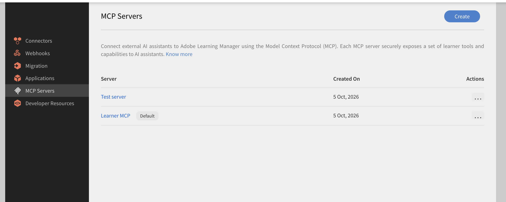

# Configurar o servidor Adobe Learning Manager MCP

Configure o servidor MCP (Protocolo de Contexto de Modelo) uma vez para sua organização. A configuração tem duas partes: criar um servidor MCP no Learning Manager e conectá-lo ao assistente de IA. Depois disso, os alunos fazem logon no Learning Manager usando o assistente do AI e podem usar as ferramentas MCP.

Antes de começar, verifique se:

* O servidor MCP é ativado para sua conta do Learning Manager. Entre em contato com o gerente de sucesso do cliente da Adobe ou o suporte da Adobe para ativá-la. Até lá, cada pedido retorna 403 Proibido.
* O administrador do assistente do AI tem permissão para adicionar e configurar conectores nessa plataforma.

**Pré-requisito:** o servidor do Protocolo de Contexto de Modelo é um recurso baseado em sinalizador de back-end que funciona somente para contas de nível Ultimate.

## Criar um servidor MCP no Learning Manager

A criação de um servidor MCP configura um aplicativo OAuth e fornece o URL do servidor MCP, a ID do cliente e o Segredo do cliente.

1. Faça logon no Learning Manager como Administrador de Integração.
2. No menu de navegação, selecione **Servidores MCP**.
3. No canto superior direito, selecione **Criar**.

   

4. Na página **Detalhes do Aplicativo**, insira o seguinte e selecione **Próximo**:

   * **Nome do Aplicativo:** insira até 50 caracteres, por exemplo, ALM para Claude. Os alunos veem esse nome quando autorizam a conexão, portanto, escolha um nome que reconheçam.
   * **Domínios de redirecionamento:** insira o domínio de retorno de chamada de cada assistente do AI, um domínio por linha. Comece com cada um e não inclua um caminho. Esse campo é obrigatório.
   * **Descrição:** insira até 150 caracteres. Por exemplo, permite que os alunos usem o ALM de Claude.

5. Na página **Configuração de Ferramenta**, revise as ferramentas e as descrições que os assistentes de IA usam para decidir quando chamar cada ferramenta. Para alterar uma descrição, selecione **Ações** (**...**) \> **Editar**. Para restaurar o padrão, selecione **Redefinir**. Depois, selecione **Próximo**.
6. Na página **Credenciais do Cliente**, copie a **URL do Servidor MCP**, a **ID do Cliente** e o **Segredo do Cliente**. Armazene-os com segurança. Você precisa deles para conectar seu assistente de IA.

O servidor MCP sempre tem o escopo do aluno, portanto não há escopos a serem selecionados.

Registre o domínio de cada assistente de IA que você planeja conectar.

| **Assistente de IA** | **Redirecionar domínio para registro** | **URL de retorno de chamada completo (referência)** |
|----|----|----|
| Claude | [https://claude.ai](https://claude.ai/) e [https://claude.com](https://claude.com/) | <https://claude.ai/api/mcp/auth_callback> |
| ChatGPT | [https://chatgpt.com](https://chatgpt.com/) | <https://chatgpt.com/connector/oauth/&lt;id>\> (O ChatGPT mostra a ID durante a configuração) |

Registre domínios exatos, como [https://chatgpt.com](https://chatgpt.com/). Não use curingas parciais, como [https://*chatgpt.com*](https://chatgpt.com)*, pois eles podem corresponder a domínios não relacionados. Para permitir subdomínios, use um curinga de rótulo inteiro, como* [*https://*.example.com](https://.example.com).

Um servidor MCP pode atender vários assistentes de IA se você listar todos os seus domínios de redirecionamento. Para revogar o acesso de um assistente sem afetar os outros, crie um servidor MCP separado para cada um. Todos os servidores usam o mesmo URL de servidor MCP.

Você precisa apenas da URL do servidor MCP. Claude e ChatGPT descobrem automaticamente os endpoints OAuth do Learning Manager. Para configuração manual, exiba **endpoints OAuth para o servidor MCP do Learning Manager**.

## Conectar Claude Pro ou Max

Consulte a documentação do Claude se essas etapas não corresponderem mais à interface.

>[!NOTE]
>
>A verbosidade das respostas às perguntas feitas muda à medida que as respostas da ferramenta answer_learning_content_question são reestruturadas e formatadas pelos clientes.

1. No Claude, vá para **Personalizar** \> **Conectores**.
2. Selecione **Adicionar** (+) e selecione **Adicionar conector personalizado**.
3. Insira os detalhes do conector e selecione **Continuar**:

   * **Nome:** insira um nome que os alunos reconheçam, por exemplo, Adobe Learning Manager.
   * **URL do servidor MCP remoto:** insira a URL do servidor MCP na página Credenciais do Cliente, no formato [https://\[alm-host\]/v1/mcp](https://[alm-host]/v1/mcp).

4. Em **Autenticação**, mantenha **entrar agora**. Claude lê as configurações e marca as opções de correspondência de OAuth do Learning Manager como *Detectado*.
5. Em **Cliente OAuth**, selecione **Usar seu próprio cliente OAuth**. Cole a **ID do Cliente** e o **Segredo do Cliente**.
6. Selecione **Adicionar**. Claude abre a página de logon do Learning Manager. Depois que você faz logon, o conector é exibido como conectado.

>[!NOTE]
>
>Claude rotula o campo Segredo do cliente como opcional, mas o Learning Manager o exige. Se você deixá-lo vazio ou inserir um valor incorreto, o logon falhará com a mensagem “Falha na autorização”.

## Conectar Claude para equipes ou corporações

Somente um Proprietário da organização, ou um membro com uma função que possa gerenciar conectores, pode adicionar o conector. Os membros nunca veem a ID do cliente ou o Segredo do cliente.

>[!NOTE]
>
>A verbosidade das respostas às perguntas feitas muda à medida que as respostas da ferramenta answer_learning_content_question são reestruturadas e formatadas pelos clientes.

1. No Claude, faça logon como proprietário da organização ou membro com permissão para gerenciar conectores.
2. Vá para **Configurações da organização** \> **Conectores**.
3. Selecione **Adicionar**, passe o mouse sobre **Personalizado** e selecione **Web**.
4. Insira o nome e a URL do servidor MCP e defina a **Autenticação** e o **cliente OAuth** conforme descrito nas etapas 4 e 5 do procedimento anterior.
5. Selecione **Adicionar**.

O conector agora está disponível para sua organização. Cada membro seleciona **Conectar** e faz logon no Learning Manager com sua própria conta.

## Conectar ChatGPT para equipes ou corporações

>[!NOTE]
>
>A verbosidade das respostas às perguntas feitas muda à medida que as respostas da ferramenta answer_learning_content_question são reestruturadas e formatadas pelos clientes.

1. Faça logon no ChatGPT como proprietário ou administrador do espaço de trabalho.
2. Na barra lateral esquerda, clique em **Plug-ins**.
3. Clique em **Adicionar** no canto superior direito e selecione **Criar Aplicativo MCP**.
4. Na janela **Novo Plug-in**, configure a conexão:

   * **Nome:** Adobe Learning Manager ou o nome pelo qual os alunos conhecem sua plataforma de aprendizado.
   * **Conexão:** mantenha a **URL do servidor** selecionada e insira [https://\[alm-host\]/v1/mcp](https://[alm-host]/v1/mcp)
   * **Autenticação:** OAuth

     

5. Clique em **Configurações OAuth avançadas**. O ChatGPT descobre os endpoints OAuth do ALM automaticamente.
6. Em **Registro de cliente**, mantenha o **método de registro** definido como **Cliente OAuth definido pelo usuário** e insira a **ID de cliente OAuth** e o **segredo de cliente OAuth** da etapa 1.
7. Verifique a **URL de retorno de chamada** mostrada neste painel. Seu domínio (<https://chatgpt.com>) deve estar nos **Domínios de redirecionamento** do servidor MCP da Etapa 1.

   

**Os pontos de extremidade são descobertos automaticamente**

Normalmente, você não precisa alterar os pontos de extremidade OAuth. Se o ChatGPT solicitar, use: URL de Autenticação [https://\[alm-host\]/oauth/o/authorize](https://[alm-host]/oauth/o/authorize), URL de Token [https://\[alm-host\]/oauth/token](https://[alm-host]/oauth/token), URL de Registro vazia, Recurso [https://\[alm-host\]/v1/mcp](https://[alm-host]/v1/mcp), aluno de escopo:write.

1. Selecione **Entendo e quero continuar** e clique em **Criar**.
1. Na janela **Conectar**, clique em **Continuar** e entre no ALM. A janela deve mostrar *Aprovado pelo administrador*.
1. Disponibilize o plug-in para os usuários de destino em seu espaço de trabalho.

## Autenticação do usuário final

Depois que o administrador concluir a configuração do servidor MCP, os alunos adicionarão o conector ALM da lista de conectores do assistente do AI e clicarão em **Conectar**. Isso abre a página de logon do ALM. Após fazer logon (com SSO, se sua conta o usar) e aprovar o acesso, o assistente de IA é vinculado à conta ALM do aluno.

## Girar o Segredo do cliente ou revogar o acesso

Não é possível gerar novamente um Segredo do cliente. Para girá-lo:

1. Crie um novo servidor MCP, conforme descrito anteriormente neste artigo.
2. Atualize seu assistente de IA com a nova ID do cliente e o Segredo do cliente.
3. Em **Administradores de Integração** \> **Servidores MCP**, selecione **Ações** (**...**) \> **Excluir** do servidor antigo.

Os alunos devem fazer logon novamente depois de alternar.

Para desconectar um assistente do AI para todos os alunos, exclua seu servidor MCP da mesma página.

## Ferramentas disponíveis

O servidor MCP expõe as seguintes ferramentas. Todos eles são executados com as permissões do aluno conectado.

<table style="width:100%;">
<colgroup>
<col style="width: 46%" />
<col style="width: 31%" />
<col style="width: 21%" />
</colgroup>
<thead>
<tr>
<th><strong>Ferramenta</strong></th>
<th><strong>O que ela faz</strong></th>
<th><strong>Exemplos de prompts</strong></th>
</tr>
</thead>
<tbody>
<tr>
<td>search_learning_itemsread-only</td>
<td>Pesquisa no catálogo cursos, programações de aprendizado, certificações, ajudas de tarefa, medalhas, habilidades, catálogos e etiquetas. Filtros: tipo, estado do aluno, habilidade, tag, catálogo, formato de entrega, preço e idioma. Retorna até 10 resultados por página.</td>
<td>“Cursos de Python para iniciantes” 
“Treinamentos em sala de aula grátis em francês”</td>
</tr>
<tr>
<td>list_my_learning_enrollmentsread-only</td>
<td>Lista o aprendizado inscrito, em andamento e concluído do aluno, com estado, progresso e prazo final. O mais recente está inscrito primeiro por padrão.</td>
<td>“Em que estou inscrito?” 
“O que deve acontecer em breve?” 
“Meus treinamentos concluídos”</td>
</tr>
<tr>
<td>get_learning_objectread-only</td>
<td>Obtém detalhes completos de um curso, caminho de aprendizado, certificação ou ajuda de tarefa por ID, incluindo opcionalmente instâncias, habilidades e subitens.</td>
<td>“Conte-me mais sobre o segundo curso”</td>
</tr>
<tr>
<td>get_my_learning_profileread-only</td>
<td>Obtém o perfil ALM do aluno, incluindo a conta e o gerente.</td>
<td>“Quem é meu gerente no ALM?”</td>
</tr>
<tr>
<td>answer_learning_content_questionuses créditos de IA</td>
<td>Responde a perguntas sobre o assunto do curso usando o Assistente de aprendizado ALM, com base no conteúdo do curso com citações. Retorna uma ID de conversa que o assistente usa para perguntas de acompanhamento.</td>
<td>“Explique o TCP versus o UDP como abordado no meu curso sobre rede”</td>
</tr>
<tr>
<td>custom_learning_path</td>
<td>Fornece caminhos de aprendizado personalizados no Adobe Learning Manager personalizados para os objetivos, tópicos e necessidades de aprendizado de um aluno. Oferece suporte à geração de recomendações de curso, ao salvamento de um caminho de aprendizado selecionado na conta do aluno, à lista de caminhos de aprendizado salvos do aluno (lista de ações) e à obtenção de detalhes e cursos de um caminho de aprendizado salvo por sua ID (detalhes da ação). Ajuda os alunos a identificar conteúdo de aprendizado relevante para desenvolver habilidades e alcançar objetivos de aprendizado.</td>
<td>“Salve o caminho de aprendizado selecionado na minha conta.”</td>
</tr>
</tbody>
</table>

As conversas iniciadas por meio de answer_learning_content_question aparecem no relatório Conversas de IA do aluno, o mesmo que as conversas no Assistente de aprendizado do ALM.

## Limites

| **Limite** | Valor **1&rbrace;** |
|----|----|
| Resultados por página (pesquisa e inscrições) | Até dez. Use o cursor retornado para mais páginas. |
| taxa de answer_learning_content_question | 10 solicitações por minuto por aluno (intermitência de 5), com no máximo 2 em andamento de uma só vez |
| Versões de protocolo MCP com suporte | 2025-11-25, 2025-06-18, 2025-03-26 |
| Transporte | HTTP de fluxo contínuo, sem estado (somente POST; nenhum fluxo de eventos enviado pelo servidor) |

## **Referência de pontos de extremidade OAuth**

Claude e ChatGPT descobrem isso automaticamente. Eles estão listados aqui para clientes ou proxies que precisam inseri-los manualmente. Substitua \[alm-host\] pelo host no URL do servidor MCP (seu host de região ou domínio personalizado do ALM).

| Valor **1&rbrace;** | **URL** |
|----|----|
| URL do servidor MCP | [https://\[alm-host\]/v1/mcp](https://[alm-host]/v1/mcp) |
| URL de autorização | [https://\[alm-host\]/oauth/o/authorize](https://[alm-host]/oauth/o/authorize) |
| URL do token | [https://\[alm-host\]/oauth/token](https://[alm-host]/oauth/token) |
| Atualizar URL | [https://\[alm-host\]/oauth/token/refresh](https://[alm-host]/oauth/token/refresh) |
| Base do servidor de autorização | &lbrack;https://\[alm-host](https://[alm-host)\] |
| Recurso | [https://\[alm-host\]/v1/mcp](https://[alm-host]/v1/mcp) |
| Escopo | aluno:write |

## Solução de problemas

| **Sintoma** | **Causa e correção** |
|----|----|
| Redirecionamento não registrado durante o logon | O domínio de retorno de chamada do assistente de IA não está nos **Domínios de redirecionamento** do aplicativo. Adicione-o (por exemplo, <https://claude.ai>) e tente novamente. |
| O logon é bem-sucedido, então o assistente informa falha na autorização (cliente inválido) | O Segredo do cliente inserido no assistente não corresponde ao aplicativo. Copie-o novamente do ALM, verifique se há espaços extras e reconecte. |
| Todas as solicitações retornam 403 Proibido | O servidor MCP não está habilitado para sua conta. Entre em contato com o suporte de Adobe. |
| Conectado como usuário errado do ALM | O navegador já tinha uma sessão ALM. Desconecte-se, faça logoff do ALM (ou use uma janela privada) e conecte-se novamente. |
| “Limite de taxa excedido” da ferramenta de Perguntas e Respostas | O aluno excedeu o limite de taxa de perguntas e respostas. Aguarde um minuto e tente novamente. |
| O assistente pede para fazer logon novamente | O token do aluno expirou ou foi revogado. Clique em **Conectar** novamente. |

## Perguntas frequentes

### **Os alunos podem usar o servidor MCP sem um administrador configurá-lo?**

Não. Um administrador de integração deve criar um servidor MCP no ALM (Etapa 1), pois o servidor MCP não oferece suporte ao registro de cliente dinâmico.

### **Podemos usar nosso próprio domínio?**

Sim Se a sua conta do ALM tiver um domínio personalizado, use-o no lugar de \[alm-host\] em todos os URLs.

### **Quais funções do ALM podem usar o servidor MCP?**

Qualquer usuário do ALM pode se conectar. As ferramentas agem no contexto do aluno e as próprias verificações de permissão do ALM se aplicam a cada solicitação.
